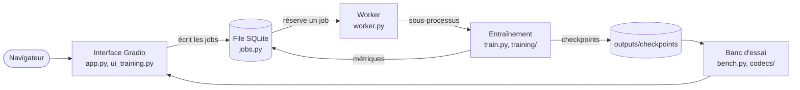
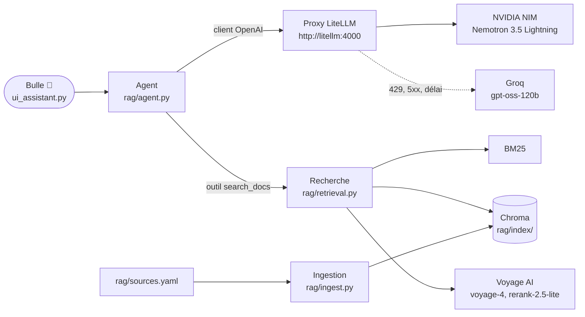

# aidge-train

**Plateforme d'entraînement et banc d'essai pour choisir le modèle de compression d'images embarqué à bord d'un rover lunaire, sur une cible CPU + FPGA.**

[](https://github.com/Aidge-in-space-hackathon/aidge-train/actions/workflows/ci-cd.yml)
[](https://aidge-in-space-hackathon.github.io/aidge-train/)


Ce dépôt est développé par l'équipe AIDGE IN SPACE dans le cadre du [Challenge Aidge 2026](https://eclipse.dev/aidge/), sur le cas d'usage proposé par **Viveris** et le **CNES**. Un rover lunaire produit plus d'images que sa liaison ne peut en transmettre : l'équipe embarque donc un encodeur neuronal, issu des travaux de [Ballé et al. (ICLR 2017)](https://arxiv.org/abs/1611.01704), porté sur un SoC CPU + FPGA par la chaîne ONNX → [Aidge](https://eclipse.dev/aidge/) → [LoCod](https://github.com/viveris/LoCod).

Choisir ce modèle demande d'entraîner de nombreuses variantes et de les comparer entre elles et aux codecs classiques. `aidge-train` réunit les deux outils nécessaires :

- une **plateforme d'entraînement** : chaque membre de l'équipe lance ses entraînements depuis le navigateur, sur une carte graphique partagée ;
- un **banc d'essai de compression** : débit, qualité et coût de calcul de chaque modèle, face à JPEG, JPEG 2000 et WebP.

Le notebook de référence, le portage Aidge et LoCod et le travail sur la carte vivent dans d'autres dépôts.

## Sommaire

- [Démarrage rapide](#démarrage-rapide)
- [Banc d'essai de compression](#banc-dessai-de-compression)
- [Plateforme d'entraînement](#plateforme-dentraînement)
- [Architecture](#architecture)
- [Configuration](#configuration)
- [Assistant RAG](#assistant-rag)
- [Contribuer](#contribuer)
- [Déploiement](#déploiement)
- [État du projet](#état-du-projet)
- [Documentation](#documentation)
- [Références](#références)
- [Licence](#licence)

## Démarrage rapide

L'équipe utilise l'instance déployée sur <https://aidge-train.gvrt.fr> (identifiants requis), sans rien installer. Les deux méthodes ci-dessous servent à développer ou à tester en local. Elles sont exclusives : une interface lancée dans le venv et un worker lancé dans Docker n'utilisent pas la même file d'attente.

### Avec un environnement virtuel Python

Prérequis : Python 3.10 ou supérieur. Le script crée `.venv/` et installe les dépendances de [`requirements.txt`](requirements.txt).

**Windows**

```powershell
powershell -ExecutionPolicy Bypass -File scripts\setup_venv.ps1
scripts\lancer_plateforme.bat
```

**Linux et macOS**

```bash
sh scripts/setup_venv.sh
sh scripts/lancer_plateforme.sh
```

Le lanceur démarre le worker et l'interface, puis ouvre <http://127.0.0.1:7860>.

Sous Windows, le PyTorch installé par défaut utilise uniquement le CPU. Pour entraîner sur une carte NVIDIA :

```powershell
.venv\Scripts\python -m pip install torch --index-url https://download.pytorch.org/whl/cu126 --force-reinstall
```

Les paquets Aidge ne sont publiés que pour Windows et Linux x86_64 : ailleurs (macOS, ARM), le moteur Aidge n'est pas disponible.

### Avec Docker

Prérequis : une carte NVIDIA, avec le NVIDIA Container Toolkit ou Docker Desktop + WSL2. Sans carte NVIDIA, le worker ne peut pas démarrer : utilisez le venv.

```bash
docker compose up --build
```

L'interface répond ensuite sur <http://localhost:7860>. Le dépôt est monté dans les conteneurs : le code modifié est pris en compte au redémarrage.

### Données et résultats

Ces dossiers sont créés à l'usage et ignorés par Git.

| Dossier | Contenu |
| :- | :- |
| `data/train/<jeu>/` | jeux d'images d'entraînement, téléchargés ou déposés depuis l'onglet 1. Entraîner, ou copiés à la main |
| `data/kodak/` | les 24 images de test Kodak, téléchargées au premier entraînement |
| `outputs/checkpoints/` | modèles entraînés, détectés automatiquement par le banc d'essai |
| `outputs/bench/` | résultats des campagnes (CSV) |
| `outputs/onnx/`, `outputs/weights/` | exports ONNX et poids pré-entraînés |
| `outputs/runs/` | file d'attente SQLite et journaux des entraînements (volume `runs` sous Docker) |

## Banc d'essai de compression

Il occupe les onglets **3. Tester** et **4. Valider** de l'interface :

| Où | Rôle |
| :- | :- |
| 3. Tester | un modèle à un niveau donné sur une image, avec la carte d'erreur et le zoom, face aux codecs cochés au même débit |
| 4. Valider | campagnes sur un jeu d'images : courbes débit/distorsion, BD-rate, temps d'encodage, export CSV |
| 4. Valider, section « Coût sur la carte » | calcul, paramètres et mémoire de la partie embarquée, couche par couche ; vérification PyTorch, ONNX Runtime et Aidge |
| Section « Aide », en bas de page | description des codecs et ajout d'un algorithme |

**Codecs disponibles**

| Famille | Codecs | Source |
| :- | :- | :- |
| Classiques | JPEG, JPEG 2000, WebP | Pillow |
| Ballé 2017 | modèles entraînés sur la plateforme | `outputs/checkpoints/` |
| Ballé 2018 | factorisé et hyperprior | poids pré-entraînés de [CompressAI](https://github.com/InterDigitalInc/CompressAI), téléchargés au premier usage |

L'encodeur des modèles appris s'exécute sur PyTorch, ONNX Runtime ou le backend CPU d'Aidge, sur un seul cœur pour que les temps restent comparables. Un entraînement en cours sur la même machine fausse ces mesures. Le backend Aidge est une implémentation de référence, nettement plus lente que PyTorch (environ 40 fois).

**Campagnes en ligne de commande**

Les résultats sont écrits dans `outputs/bench/` et relus par l'interface. Une campagne n'écrase jamais un CSV existant.

```bash
python -m aidge_in_space.bench --list
python -m aidge_in_space.bench --codecs jpeg,jpeg2000,bmshj2018-hyperprior --images 24 --mode rgb --points 6
```

Options utiles : `--backend torch|onnxruntime|aidge` et `--real-rate` (vrai codeur arithmétique au lieu du débit estimé, plus lent).

**Ajouter un algorithme**

Tout module de [`aidge_in_space/codecs/`](aidge_in_space/codecs) qui définit une fonction `codecs()` est découvert automatiquement : le codec apparaît alors dans l'interface, la ligne de commande et les tests. La marche à suivre figure dans la [documentation du code](https://aidge-in-space-hackathon.github.io/aidge-train/).

## Plateforme d'entraînement

Deux onglets ouvrent le parcours :

- **1. Entraîner** : partir d'un préréglage ou régler les hyperparamètres, en niveaux de gris ou en couleur, avec un job par valeur de λ. La section « Ajouter des images » télécharge un jeu prêt à l'emploi (vues aériennes, sol martien, terrain lunaire analogue, animaux, photos variées) ou reçoit des images et des archives zip ;
- **2. Suivre** : statuts, courbes, annulation et relance, avec reprise depuis le dernier checkpoint. Le bouton « Tester ce modèle » ouvre l'onglet 3 sur le modèle choisi.

Les modèles terminés apparaissent dans les onglets 3. Tester et 4. Valider, à côté des codecs classiques. Le mode d'emploi pas à pas est dans le [guide de l'interface](docs/guide_interface.md).

Un entraînement peut aussi se lancer sans file d'attente, à partir d'un fichier YAML contenant les champs de `TrainConfig` ([`aidge_in_space/training/config.py`](aidge_in_space/training/config.py)) :

```bash
python -m aidge_in_space.train --config mon_essai.yaml --out outputs/essais --device cuda
```

Sans `--out`, le checkpoint est écrit sous le nom `bls2017_c{canaux}_N{N}_lambda{λ}.pt` et peut remplacer un fichier existant de même nom.

## Architecture

L'interface n'entraîne jamais elle-même : elle écrit des jobs dans une file SQLite, et le worker exécute chacun d'eux dans un sous-processus.



| Module | Rôle |
| :- | :- |
| `aidge_in_space/app.py` | interface Gradio |
| `aidge_in_space/ui_training.py` | onglets 1. Entraîner et 2. Suivre |
| `aidge_in_space/dataset_catalog.py` | catalogue des jeux d'images téléchargeables |
| `aidge_in_space/jobs.py` | file d'attente SQLite : jobs, métriques, workers |
| `aidge_in_space/worker.py` | prise en charge des jobs et lancement des entraînements |
| `aidge_in_space/train.py`, `training/` | ligne de commande, boucle d'entraînement, checkpoints, reprise, préréglages |
| `aidge_in_space/bench.py` | campagnes de mesures |
| `aidge_in_space/codecs/` | registre de codecs et implémentations |
| `aidge_in_space/nn.py`, `coding.py`, `entropy.py` | architectures, GDN, modèles d'entropie, codeur arithmétique |
| `aidge_in_space/backends.py`, `profiling.py`, `metrics.py` | moteurs d'exécution, profil de la partie embarquée, PSNR, MS-SSIM, BD-rate |

## Configuration

| Variable | Défaut | Rôle |
| :- | :- | :- |
| `AIDGE_RUNS_DIR` | `outputs/runs` (`/runs` sous Docker) | emplacement de la file d'attente et des journaux |
| `AIDGE_UI_HOST` | `127.0.0.1` | adresse d'écoute de l'interface |
| `AIDGE_UI_BIND` | `127.0.0.1` | sous Docker, adresse de l'hôte qui publie le port 7860 |
| `AIDGE_MAX_UPLOAD_MB` | `500` | taille maximale d'un dépôt d'images |
| `AIDGE_ATTENTE_MAX` | `120` | attente maximale du lanceur, en secondes |

Sous Docker, ces valeurs se placent dans l'environnement ou dans un fichier `.env`, jamais versionné.

## Assistant RAG

Une bulle 💬, en bas à droite de tous les onglets, ouvre un assistant qui répond aux questions de l'équipe sur le papier de Ballé, l'article ERTS sur Aidge, la documentation d'Aidge 0.10.1 et de LoCod, et les docs de ce dépôt. Il répond en français et cite le fichier et la page de chaque passage utilisé. Si rien de pertinent n'est trouvé, il répond « je ne sais pas ». Il n'utilise que des offres gratuites.

### Architecture



- **Sources** : [`rag/sources.yaml`](rag/sources.yaml) est la seule liste de référence. Chaque téléchargement est épinglé (version arXiv, version HAL, tag ou commit Git) et vérifié par SHA-256 : un fichier modifié à la source est refusé. La plaquette et la présentation du challenge, privées, se copient à la main dans `rag/sources/private/`. Elles ne sont ingérées qu'en local, jamais en CI ni dans l'artefact d'index.
- **Découpage** : les documents sont découpés par section (titres Markdown et reStructuredText, table des matières des PDF), en passages d'environ 800 tokens avec 100 de chevauchement. Chaque passage garde son fichier, sa page et sa section.
- **Recherche** :
  - BM25 et vecteurs Chroma, fusionnés par RRF ;
  - rerank Voyage des 8 meilleurs candidats ;
  - 5 passages rendus au LLM.
- **Agent** : il appelle les outils au plus 4 fois. Le registre d'outils ([`rag/tools.py`](rag/tools.py)) ne contient que `search_docs` pour l'instant.

### Mise en route

1. Copier [`.env.example`](.env.example) en `.env`, puis renseigner `LITELLM_MASTER_KEY` (une clé de votre choix commençant par `sk-`), `NVIDIA_NIM_API_KEY`, `GROQ_API_KEY` et, si possible, `VOYAGE_API_KEY`.
2. Lancer `docker compose up --build`. Le service `litellm` démarre avec l'app et n'est publié sur aucun port de l'hôte : seule l'app l'appelle.
3. Au premier démarrage, l'app construit l'index en arrière-plan (journal : `rag/index/ingest.log`) :
   - d'abord en local avec fastembed, sans clé, en 2 minutes environ ;
   - puis avec Voyage, plus long : les 435 passages, environ 134K tokens, se calculent en un quart d'heure environ au rythme de l'offre gratuite.

   Seuls les passages qui changent sont recalculés ensuite.

| Variable | Défaut | Rôle |
| :- | :- | :- |
| `LITELLM_MASTER_KEY` | aucune | clé du proxy LiteLLM, partagée par le proxy et l'app ; sans elle, la bulle est désactivée |
| `NVIDIA_NIM_API_KEY` | aucune | fournisseur principal ([build.nvidia.com](https://build.nvidia.com)) |
| `GROQ_API_KEY` | aucune | fournisseur de secours ([console.groq.com](https://console.groq.com)) |
| `VOYAGE_API_KEY` | aucune | embeddings et rerank ([dash.voyageai.com](https://dash.voyageai.com)) ; sans elle, repli local |
| `EMBEDDINGS_BACKEND` | `auto` | `auto` (Voyage si la clé est là, plus le repli local), `voyage` ou `local` |
| `AIDGE_ASSISTANT_TRUSTED_AUTH` | non défini | `1` : autorise la bulle sur une interface exposée au réseau, à condition qu'une authentification la protège |
| `AIDGE_ASSISTANT_AUTO_INGEST` | `1` | `0` : pas de construction automatique de l'index au démarrage |

### Commandes

```bash
python -m rag.ingest                    # (re)construit l'index ; --if-stale : seulement si les sources ont changé
python -m rag.ingest --backend local    # sans clé Voyage
python -m rag.ask "Comment fonctionne la GDN ?"
python -m rag.ask --search-only "GDN"   # passages trouvés, sans LLM
python -m rag.eval.run [--llm]          # questions de référence (rag/eval/questions.yaml), hors CI
python -m pytest tests/rag              # tests unitaires, sans réseau
python -m pytest litellm/test_fallback.py   # bascule LiteLLM hors ligne (pip install litellm==1.106.8)
docker compose exec app python litellm/test_fallback.py --live --url http://litellm:4000   # bascule réelle
```

### Bascule entre fournisseurs

Le modèle `assistant` du proxy ([`litellm/config.yaml`](litellm/config.yaml)) appelle NVIDIA NIM. Il bascule sur Groq dans trois cas :
- un 429 (quota épuisé), sans nouvelle tentative ;
- une erreur 5xx, après une nouvelle tentative ;
- un délai de 45 s dépassé.

Un fournisseur en échec est mis à l'écart 60 s : les questions suivantes vont directement au secours. Si les deux fournisseurs échouent, la bulle affiche un message clair. Les embeddings ont aussi leurs replis :
- quota Voyage atteint : vecteurs locaux ;
- rerank impossible : ordre RRF.

### Limites des offres gratuites

- **Voyage, sans moyen de paiement** : 3 requêtes et 10K tokens par minute. Une question consomme 2 requêtes (embedding et rerank). Au-delà de 3 s d'attente, la question passe en local, avec une recherche de moindre qualité. Le rerank est limité à 8 candidats pour tenir dans ce budget. Les 200 M de tokens offerts ne s'épuisent pas à cette échelle.
- **NVIDIA NIM** : endpoint gratuit « Prototype », régi par les conditions d'essai NVIDIA, prévu pour le prototypage et non pour la production. Le débit et la durée de l'offre peuvent changer sans préavis.
- **Groq** : quotas par minute et par jour limités (environ 8K tokens par minute pour gpt-oss-120b, à vérifier dans la console). Une question en consomme environ 4K (passages tronqués à 1 200 caractères) : le secours encaisse une à deux questions par minute, pas plus.
- **Exposition** : ces quotas sont partagés par toute l'équipe. La bulle est donc désactivée dès que l'interface est joignable depuis le réseau sans authentification devant. LiteLLM n'est jamais publié. Le déploiement en production fera l'objet d'une PR séparée.
- **Licence** : PyMuPDF, qui lit les PDF, est sous licence AGPL-3.0, ce qui reste compatible tant que le dépôt et l'image restent publics.

### Index et CI

L'index (`rag/index/`) n'est pas versionné. Le workflow [`rag.yml`](.github/workflows/rag.yml) comporte deux jobs :
- **Lint et tests**, à chaque modification de l'assistant : ruff, tests de l'assistant et bascule LiteLLM hors ligne, sans réseau ni secret.
- **Reconstruction de l'index**, quand les sources changent : ingestion avec Voyage des seules sources publiques, publiée en artefact pendant 30 jours. L'artefact contient l'index et un manifeste : empreinte des sources, modèle d'embedding, date. Ce job demande le secret de dépôt `VOYAGE_API_KEY`.

En local, l'app reconstruit l'index elle-même si l'index est absent ou si l'empreinte des sources a changé (`--if-stale`). Télécharger l'artefact demanderait un jeton GitHub, même sur un dépôt public : cette option reste à ajouter si la reconstruction locale devient trop lente.

## Contribuer

`main` n'évolue que par pull request, avec une CI au vert : tests, fichiers compose, construction de l'image et démarrage de l'application et du worker. Dependabot propose chaque semaine les mises à jour de dépendances, soumises à la même CI : les mineures (pip, GitHub Actions) sont fusionnées automatiquement si elle réussit, les majeures et l'image Docker restent à valider à la main.

```bash
python -m pytest tests                  # tous les tests
python -m pytest tests/test_jobs.py -q  # un seul fichier
```

Conventions du projet :

- les messages de commit, la documentation et les libellés de l'interface sont en français ;
- chaque module, classe, fonction et méthode porte une docstring Doxygen (`"""! @brief ...`), et un test le vérifie ;
- chaque constante ou attribut est documenté par un commentaire `##` sur la ligne précédente.

## Déploiement

La plateforme tourne dans une VM du homelab de l'équipe, équipée d'une RTX 2060 SUPER (8 Go). À chaque merge sur `main`, la CI publie les images sur GHCR (`ghcr.io/aidge-in-space-hackathon/aidge-train`), puis un runner auto-hébergé les déploie, vérifie que l'interface répond et revient à la version précédente en cas d'échec. Mise en place et exploitation : [guide de déploiement](docs/deploiement.md).

## État du projet

| Fonction | État |
| :- | :- |
| Banc d'essai : codecs classiques, Ballé 2017, Ballé 2018 | disponible |
| Entraînement Ballé 2017, en gris et en couleur | disponible |
| CI/CD et publication des images | disponible |
| Assistant RAG (bulle de chat), en local | disponible |
| Assistant RAG en production, outils search_code, get_runs et suggest_config | prévu |
| Entraînement Ballé 2018 hyperprior | prévu (inférence seule aujourd'hui) |
| Deux entraînements simultanés sur la carte | prévu (un job à la fois aujourd'hui) |
| Instance banc d'essai seul pour le jury et les partenaires | prévu |
| Identification des auteurs de jobs par Authelia | prévu |
| Variantes allégées pour le FPGA | prévu |

La feuille de route complète figure dans le [cahier des charges](docs/cahier_des_charges.md). Les livrables du challenge sont attendus le 31 décembre 2026, la soutenance a lieu le 14 janvier 2027.

## Documentation

| Document | Contenu |
| :- | :- |
| [Cahier des charges](docs/cahier_des_charges.md) | besoins, utilisateurs, infrastructure, feuille de route |
| [Guide de l'interface](docs/guide_interface.md) | mode d'emploi pour l'équipe |
| [Conception de l'entraînement](docs/conception_entrainement.md) | file d'attente, worker, contrats détaillés |
| [Guide de déploiement](docs/deploiement.md) | mise en production et exploitation |
| [Documentation du code](https://aidge-in-space-hackathon.github.io/aidge-train/) | référence générée par Doxygen |

## Références

- J. Ballé, V. Laparra, E. P. Simoncelli, *End-to-end Optimized Image Compression*, ICLR 2017 ([arXiv:1611.01704](https://arxiv.org/abs/1611.01704))
- J. Ballé, D. Minnen, S. Singh, S. J. Hwang, N. Johnston, *Variational Image Compression with a Scale Hyperprior*, ICLR 2018 ([arXiv:1802.01436](https://arxiv.org/abs/1802.01436))
- C. Moineau et al., *Aidge: A comprehensive and traceable library for deploying standalone embedded deep neural networks*, ERTS 2026 ([HAL](https://hal.science/hal-05513843))
- [Eclipse Aidge](https://eclipse.dev/aidge/), [LoCod](https://github.com/viveris/LoCod), [CompressAI](https://github.com/InterDigitalInc/CompressAI)

## Licence

Le code de ce dépôt est distribué sous licence MIT : voir le fichier [`LICENSE`](LICENSE). Elle ne couvre pas les jeux d'images ni les poids pré-entraînés téléchargés à l'usage, qui gardent la licence de leur source.
