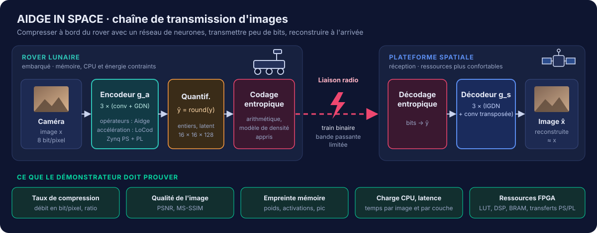
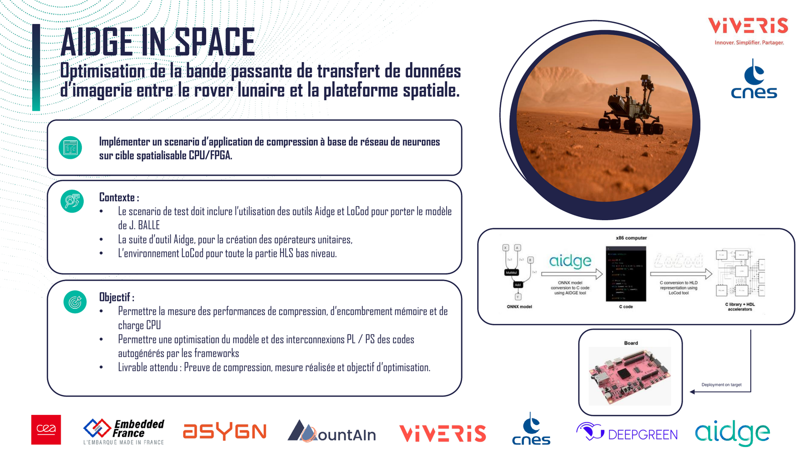
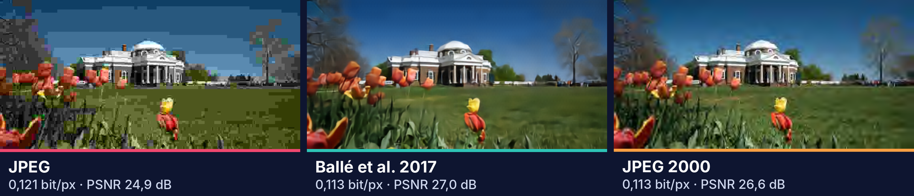
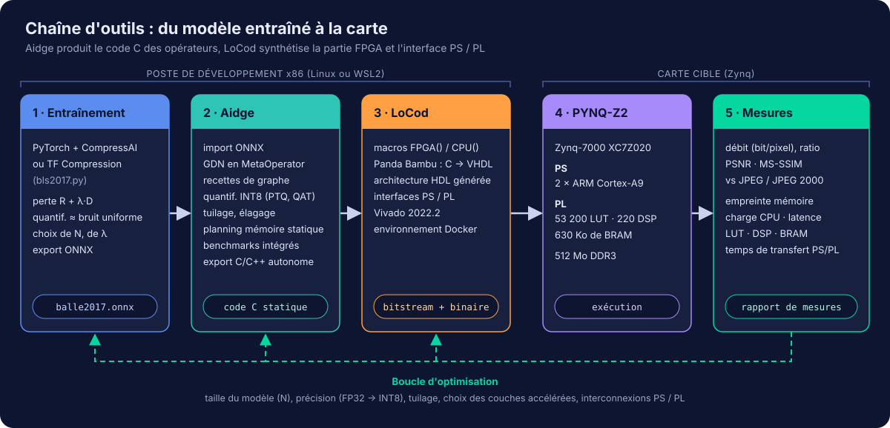
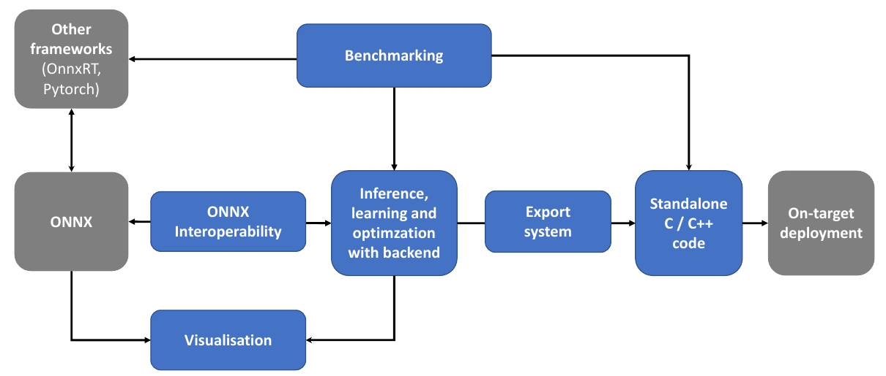

# aidge-train

**Plateforme d'entraînement et banc d'essai de l'équipe AIDGE IN SPACE : entraîner, comparer et choisir le modèle de compression d'images qui ira à bord d'un rover lunaire, sur une cible CPU + FPGA.**




Un rover lunaire produit beaucoup plus d'images que sa liaison radio ne peut en transmettre. L'équipe embarque à bord un **encodeur neuronal** (le modèle de compression de J. Ballé et al., ICLR 2017) qui transforme chaque image en un petit train binaire. Choisir ce modèle demande d'en entraîner beaucoup de variantes et de les comparer entre elles et aux codecs classiques : c'est le rôle de ce dépôt.

`aidge-train` réunit une **plateforme d'entraînement** (chaque membre de l'équipe lance ses entraînements depuis le navigateur, sur une carte graphique partagée) et un **banc d'essai de compression** (débit, qualité et coût de calcul de chaque modèle, face à JPEG et JPEG 2000). Le notebook de référence, le portage Aidge et LoCod et le travail sur la carte vivent dans d'autres dépôts.

Ce que la plateforme doit faire, pour qui et sur quelle infrastructure : [**cahier des charges**](docs/cahier_des_charges.md).

## Sommaire

1. [Démarrage rapide](#démarrage-rapide)
    1. [En local avec Docker](#en-local-avec-docker)
    2. [En local avec un environnement virtuel Python](#en-local-avec-un-environnement-virtuel-python)
    3. [Données et résultats](#données-et-résultats)
2. [Banc d'essai de compression](#banc-dessai-de-compression)
3. [Plateforme d'entraînement](#plateforme-dentraînement)
4. [Contribuer](#contribuer)
5. [Déploiement](#déploiement)
6. [Le défi](#le-défi)
7. [Pourquoi un réseau de neurones pour compresser ?](#pourquoi-un-réseau-de-neurones-pour-compresser-)
8. [La chaîne d'outils, d'Aidge à LoCod](#la-chaîne-doutils-daidge-à-locod)
9. [Cible matérielle et répartition entre PS et PL](#cible-matérielle-et-répartition-entre-ps-et-pl)
10. [Calendrier officiel du challenge](#calendrier-officiel-du-challenge)
11. [Ressources](#ressources)
12. [Licence](#licence)

## Démarrage rapide

Une fois le serveur de l'équipe en service, la plateforme s'utilise directement dans le navigateur, sans rien installer : `aidge-train.gvrt.fr` pour l'équipe, `aidge-bench.gvrt.fr` (banc d'essai seul) pour le jury et les partenaires. Les deux options ci-dessous servent à développer ou à tester en local.

### En local avec Docker

Depuis la racine du dépôt, sur un PC avec une carte NVIDIA (NVIDIA Container Toolkit, ou Docker Desktop avec WSL2 sous Windows) :

```bash
docker compose up --build
```

Sur un PC sans carte NVIDIA :

```bash
docker compose -f docker-compose.yml -f docker-compose.cpu.yml up --build
```

Ouvrez ensuite <http://localhost:7860>. Le premier build télécharge PyTorch et prend quelques minutes. Le dépôt est **monté** dans les conteneurs (`/workspace`) : le code modifié est pris en compte au redémarrage, et `data/` et `outputs/` restent sur votre machine. Pour arrêter : `Ctrl+C`, puis `docker compose down`.

Sous Linux, les conteneurs écrivent avec l'identifiant utilisateur 1000 : si le vôtre est différent (`id -u`), donnez-lui les droits d'écriture sur `data/` et `outputs/`.

### En local avec un environnement virtuel Python

Depuis la racine du dépôt, le script crée `.venv/` et installe les dépendances de [`requirements.txt`](requirements.txt) ; le relancer plus tard met simplement les dépendances à jour.

```powershell
powershell -ExecutionPolicy Bypass -File scripts\setup_venv.ps1    # Windows
scripts\lancer_plateforme.bat                                       # worker + interface + navigateur
```

```bash
sh scripts/setup_venv.sh                                            # Linux / macOS
sh scripts/lancer_plateforme.sh
```

Sous Windows, PyTorch installé par défaut ne sait utiliser que le CPU. Pour entraîner sur GPU :

```powershell
.venv\Scripts\python -m pip install torch --index-url https://download.pytorch.org/whl/cu126 --force-reinstall
```

Sous Linux, la version par défaut gère déjà CUDA. Ne mélangez pas une interface lancée dans le venv et un worker Docker : ils n'utilisent pas la même file d'attente.

### Données et résultats

- `data/train/<jeu>/` : les jeux d'images d'entraînement (png, jpg, tif, sous-dossiers acceptés), déposés depuis l'onglet Données ou copiés à la main ;
- `data/kodak/` : les 24 images de test Kodak, **téléchargées automatiquement** au premier entraînement ;
- `outputs/` : checkpoints (`outputs/checkpoints/`), campagnes du banc d'essai (`outputs/bench/`), exports ONNX et poids pré-entraînés.

Ces dossiers sont ignorés par Git.

## Banc d'essai de compression

Le banc d'essai compare plusieurs algorithmes et modèles de compression pour justifier ce qui ira sur la carte.

| Onglet | Rôle |
| :- | :- |
| Comparer | une image, plusieurs codecs au même débit visé : reconstructions, zoom, débit, PSNR, MS-SSIM, temps |
| Explorer un codec | un codec à un niveau donné, avec la carte d'erreur |
| Benchmark | campagnes sur un jeu d'images : courbes débit/distorsion, BD-rate, temps d'encodage, CSV |
| Encodeur embarqué | calcul, paramètres et mémoire de la partie embarquée, couche par couche ; vérification PyTorch / ONNX Runtime / Aidge |

Codecs disponibles : JPEG, JPEG 2000 et WebP (références), les modèles Ballé 2017 entraînés sur la plateforme (détectés dans `outputs/checkpoints/`), Ballé 2018 factorisé et hyperprior avec les poids pré-entraînés de [CompressAI](https://github.com/InterDigitalInc/CompressAI) (téléchargés au premier usage). L'encodeur des modèles appris peut tourner sur PyTorch, ONNX Runtime ou le backend CPU d'Aidge, sur un seul cœur pour des temps comparables. Un entraînement en cours sur la même machine fausse ces temps.

**Ajouter un algorithme** : un fichier dans [`aidge_in_space/codecs/`](aidge_in_space/codecs) avec une fonction `codecs()` ; il apparaît seul dans l'interface, la ligne de commande et les tests (exemple dans l'onglet « Codecs et aide »).

Campagnes sans interface (résultats dans `outputs/bench/`, relus par l'interface) :

```bash
python -m aidge_in_space.bench --list
python -m aidge_in_space.bench --codecs jpeg,jpeg2000,bmshj2018-hyperprior --images 24 --mode rgb --points 6
```

## Plateforme d'entraînement

Trois onglets s'ajoutent au banc d'essai : **Données** (déposer des images ou un zip), **Entraînement** (partir d'un préréglage ou tout régler, un job par valeur de λ) et **Suivi** (statuts, courbes, annuler, relancer). Les entraînements passent par une file d'attente et sont exécutés par un programme séparé, le *worker* ; les modèles terminés apparaissent dans le banc d'essai, à côté de JPEG.

Les mêmes entraînements se lancent en ligne de commande, à partir des configurations de [`configs/`](configs) :

| Configuration | Contenu |
| :- | :- |
| `test_rapide.yaml`, `test_rapide_rgb.yaml` | 300 pas sur des patchs 128 × 128, pour vérifier la chaîne en quelques minutes |
| `standard_gris_N64.yaml`, `standard_gris_N128.yaml` | entraînement complet en niveaux de gris (50 000 pas) |
| `standard_rgb_N128.yaml`, `standard_rgb_N192.yaml` | entraînement complet en couleur (50 000 pas) ; N = 192 est le réglage de l'article pour la couleur |

```bash
python -m aidge_in_space.train --config configs/standard_rgb_N128.yaml --device cuda
```

Mode d'emploi pas à pas : [`docs/guide_interface.md`](docs/guide_interface.md). Conception détaillée : [`docs/conception_entrainement.md`](docs/conception_entrainement.md).

## Contribuer

On ne pousse jamais directement sur `main` : une branche par sujet, puis une pull request. La CI vérifie les tests, les fichiers compose, la construction de l'image et le démarrage de l'app et du worker ; on merge quand elle est verte.

```bash
python -m pytest tests                  # tous les tests (environ une minute)
python -m pytest tests/test_jobs.py -q  # un fichier
```

Les messages de commit, la documentation et les libellés de l'interface sont en français. Chaque module, classe, fonction et méthode a une docstring Doxygen (`"""! @brief ...`, `@param`, `@return`, `@throws`) et chaque constante ou attribut un commentaire `##` sur la ligne précédente : un test le vérifie. La documentation du code est générée par [Doxygen](https://www.doxygen.nl) (`doxygen Doxyfile`, puis `docs/html/index.html`) et publiée sur GitHub Pages à chaque push sur `main` ([workflow](.github/workflows/docs.yml)).

## Déploiement

Le serveur de l'équipe est une VM du homelab avec une RTX 2060 SUPER. Au merge sur `main`, la CI publie les images sur GHCR et un runner installé dans la VM les déploie, vérifie que l'interface répond et revient à la version précédente sinon. Mise en place et exploitation : [`docs/deploiement.md`](docs/deploiement.md).

## Le défi

Le projet répond au cas d'usage **AIDGE IN SPACE** proposé par **Viveris** et le **CNES** dans le cadre du [Challenge Aidge 2026](https://eclipse.dev/aidge/), un challenge étudiant sur l'IA embarquée qui se déroule du 1er octobre au 31 décembre 2026.



*Fiche du cas d'usage, présentation de lancement du Challenge Aidge (1er octobre 2026).*


Les objectifs fixés par Viveris et le CNES sont les suivants :

| Objectif | Ce que cela implique pour nous |
| :- | :- |
| Mesurer les performances de compression | débit en bit/pixel, qualité PSNR et MS-SSIM, comparaison à JPEG et JPEG 2000 |
| Mesurer l'encombrement mémoire et la charge CPU | instrumentation du code embarqué, rapports mémoire d'Aidge, temps par couche |
| Optimiser le modèle | quantification, réduction du nombre de canaux, tuilage, élagage |
| Optimiser les interconnexions PL / PS du code autogénéré | choix des couches accélérées, volume et fréquence des transferts AXI |
| **Livrable attendu** | **preuve de compression, mesures réalisées, objectif d'optimisation** |


## Pourquoi un réseau de neurones pour compresser ?

Les codecs classiques (JPEG, JPEG 2000) suivent tous le même schéma de *codage par transformée* : une transformée linéaire fixe (DCT, ondelettes), une quantification, puis un codage entropique, chaque étage étant réglé séparément. Dans le papier [END-TO-END OPTIMIZED IMAGE COMPRESSION](https://arxiv.org/pdf/1611.01704), Ballé, Laparra et Simoncelli remplacent la transformée linéaire par une **transformée non linéaire apprise** et optimisent les trois étages **ensemble**, de bout en bout, en minimisant un compromis débit / distorsion `R + λ·D`.



*À débit quasi identique (environ 0,11 à 0,12 bit/pixel, soit un taux de compression d'environ 200 pour 1 sur cette image couleur), le modèle appris évite les blocs de JPEG et le flou de JPEG 2000. PSNR mesuré sur la luminance. Source : Ballé et al., 2017, figure 5.*


## La chaîne d'outils, d'Aidge à LoCod



Le flot suit celui présenté dans la fiche du défi : un modèle ONNX entre dans Aidge, qui le transforme en code C ; LoCod convertit ensuite les fonctions choisies en accélérateurs matériels et génère toute l'architecture qui les relie au processeur. Les mesures sur carte alimentent une boucle d'optimisation qui remonte jusqu'au choix du modèle.

### Aidge

[Eclipse Aidge](https://eclipse.dev/aidge/) est un framework open source développé par le CEA LIST et hébergé par la fondation Eclipse. Plutôt que d'embarquer un interpréteur générique, il génère du **code C/C++ statique, spécialisé pour le modèle**, sans dépendance à un runtime. Chaque transformation du graphe reste visible et traçable, ce qui correspond bien aux exigences du spatial.



*Flot de déploiement Aidge. Source : Moineau et al., ERTS 2026, figure 1 .*


### LoCod

[LoCod](https://github.com/viveris/LoCod) est un outil open source de co-conception matériel / logiciel développé par **Viveris** et le **CNES** pour les SoC qui combinent CPU et FPGA. On écrit l'application en C, on désigne les fonctions à accélérer avec la macro `FPGA()`, et LoCod se charge du reste : conversion C vers VHDL avec [Panda Bambu](https://panda.deib.polimi.it/), génération de l'architecture HDL qui relie les accélérateurs au processeur, puis production du bitstream et de l'exécutable.


## Cible matérielle et répartition entre PS et PL

La carte prêtée par les partenaires n'est pas encore arrivée. D'après la photo de la fiche du défi et les cibles supportées par LoCod, il devrait s'agir d'une **TUL PYNQ-Z2** (à confirmer à réception).


## Calendrier officiel du challenge

| Date | Étape |
| :- | :- |
| 1er octobre 2026 | Réunion de lancement, présentation des cas d'usage et d'Aidge |
| 8 octobre 2026, 14 h | Présentation détaillée du cas d'usage par Viveris |
| 15 octobre et 5 novembre 2026, 14 h | Sessions de questions / réponses sur Aidge |
| Octobre à décembre 2026 | Réalisation du projet |
| **31 décembre 2026** | **Remise des livrables : présentation, vidéo, code** |
| 14 janvier 2027 | Soutenance devant le jury |
| 26 janvier 2027 | Remise des prix aux Assises de l'embarqué, à Bercy |


## Ressources

### Documents de référence

Les documents de référence sont publiés en ligne ; les supports internes du challenge (plaquette, présentation de lancement, cours) restent dans le dépôt privé de l'équipe.

- J. Ballé, V. Laparra, E. P. Simoncelli, *End-to-end Optimized Image Compression*, ICLR 2017 ([arXiv:1611.01704](https://arxiv.org/abs/1611.01704))
- C. Moineau et al., *Aidge: A comprehensive and traceable library for deploying standalone embedded deep neural networks*, ERTS 2026 ([HAL](https://hal.science/hal-05513843v1/document))

### Liens Aidge

[documentation](https://eclipse.dev/aidge/), [tutoriels](https://eclipse.dev/aidge/source/Tutorial/index.html), [exemples](https://gitlab.eclipse.org/eclipse/aidge/aidge/-/tree/main/examples), [code source](https://gitlab.eclipse.org/eclipse/aidge), [wiki des contributeurs](https://gitlab.eclipse.org/groups/eclipse/aidge/-/wikis/), [tchat Matrix](https://chat.eclipse.org/#/room/#aidge:matrix.eclipse.org)

### Liens LoCod

[dépôt Viveris](https://github.com/viveris/LoCod), [miroir CNES](https://github.com/CNES/LoCod), [présentation au FPGA Developers' Forum du CERN](https://indico.cern.ch/event/1381060/contributions/5923282/)

### Compression apprise

[TensorFlow Compression](https://github.com/tensorflow/compression), [CompressAI](https://github.com/InterDigitalInc/CompressAI)

### Carte

[PYNQ-Z2 (programme universitaire AMD)](https://www.amd.com/en/corporate/university-program/aup-boards/pynq-z2.html)


## Licence

Le code de ce dépôt est publié sous [licence MIT](LICENSE). LoCod est distribué sous GPL-3.0 : on l'utilise comme outil externe, sans copier son code ici, pour ne pas changer la licence du dépôt. Les figures reprises de publications sont créditées sous chacune d'elles ; la fiche du défi provient de la présentation de lancement du Challenge Aidge (CEA, Embedded France, Viveris, CNES, DeepGreen).
