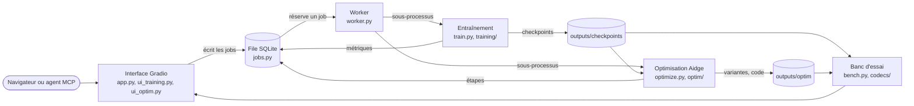
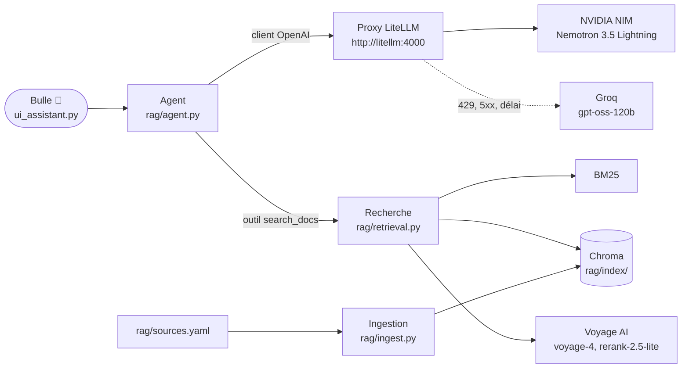

# aidge-train

**Plateforme d'entraînement, banc d'essai et chaîne d'optimisation Aidge pour choisir et préparer le modèle de compression d'images embarqué à bord d'un rover lunaire, sur une cible CPU + FPGA.**

[](https://github.com/Aidge-in-space-hackathon/aidge-train/actions/workflows/ci-cd.yml)
[](https://github.com/Aidge-in-space-hackathon/aidge-train/actions/workflows/rag.yml)
[](https://aidge-in-space-hackathon.github.io/aidge-train/)


Ce dépôt est développé par l'équipe AIDGE IN SPACE dans le cadre du [Challenge Aidge 2026](https://eclipse.dev/aidge/), sur le cas d'usage proposé par **Viveris** et le **CNES**. Un rover lunaire produit plus d'images que sa liaison ne peut en transmettre : l'équipe embarque donc un encodeur neuronal, issu des travaux de [Ballé et al. (ICLR 2017)](https://arxiv.org/abs/1611.01704), porté sur un SoC CPU + FPGA par la chaîne ONNX → [Aidge](https://eclipse.dev/aidge/) → [LoCod](https://github.com/viveris/LoCod).

`aidge-train` couvre tout le parcours d'un modèle, depuis le navigateur, dans une même interface à cinq onglets :

| Onglet | Rôle |
| :- | :- |
| **1. Entraîner** | lancer des entraînements Ballé 2017 sur une carte graphique partagée, déposer ou télécharger des jeux d'images |
| **2. Suivre** | statuts, courbes, annulation, relance avec reprise depuis le dernier checkpoint |
| **3. Tester** | un modèle sur une image, face à JPEG, JPEG 2000 et WebP au même débit |
| **4. Valider** | campagnes débit/distorsion, BD-rate, temps d'encodage, coût de l'encodeur sur la carte |
| **5. Optimisation Aidge** | quantification par Aidge, mémoire face à la BRAM du FPGA, export C++ vérifié et fichier C pour LoCod |

S'y ajoutent un assistant documentaire (bulle 💬 sur tous les onglets) et un accès MCP pour piloter la plateforme depuis un agent IA. Le notebook de référence, la synthèse matérielle complète par LoCod et les mesures sur la carte vivent dans d'autres dépôts.

## Sommaire

- [Démarrage rapide](#démarrage-rapide)
- [Plateforme d'entraînement](#plateforme-dentraînement)
- [Banc d'essai de compression](#banc-dessai-de-compression)
- [Optimisation Aidge](#optimisation-aidge)
- [Architecture](#architecture)
- [Configuration](#configuration)
- [Accès MCP pour les agents](#accès-mcp-pour-les-agents)
- [Assistant RAG](#assistant-rag)
- [Contribuer](#contribuer)
- [Déploiement](#déploiement)
- [État du projet](#état-du-projet)
- [Documentation](#documentation)
- [Références](#références)
- [Licence](#licence)

## Démarrage rapide

L'équipe utilise l'instance déployée sur <https://aidge-train.gvrt.fr>, réservée à ses membres, sans rien installer. Les deux méthodes ci-dessous servent à développer ou à tester en local. Elles sont exclusives : une interface lancée dans le venv et un worker lancé dans Docker n'utilisent pas la même file d'attente.

### Avec un environnement virtuel Python

Prérequis : Python 3.10 ou supérieur. Le script crée `.venv/` et installe les dépendances de [`requirements.txt`](requirements.txt), Aidge 0.10.1 compris.

**Windows**

```powershell
powershell -ExecutionPolicy Bypass -File scripts\setup_venv.ps1
scripts\lancer_plateforme.bat
```

**Linux et macOS**

```bash
sh scripts/setup_venv.sh
sh scripts/lancer_plateforme.sh
```

Le lanceur ouvre deux fenêtres (« AIDGE - worker » et « AIDGE - interface »), attend que l'interface réponde puis ouvre <http://127.0.0.1:7860>. Fermer les deux fenêtres arrête la plateforme ; un entraînement en cours est sauvegardé et pourra être relancé.

Sous Windows, le PyTorch installé par défaut utilise uniquement le CPU. Pour entraîner sur une carte NVIDIA :

```powershell
.venv\Scripts\python -m pip install torch --index-url https://download.pytorch.org/whl/cu126 --force-reinstall
```

Les paquets Aidge ne sont publiés que pour Windows et Linux x86_64 : ailleurs (macOS, ARM), le moteur Aidge et l'onglet 5 ne sont pas disponibles. Sans g++, l'onglet 5 produit le code sans pouvoir le vérifier.

### Avec Docker

Prérequis : une carte NVIDIA, avec le NVIDIA Container Toolkit ou Docker Desktop + WSL2. Sans carte NVIDIA, le worker ne peut pas démarrer : utilisez le venv.

```bash
docker compose up --build
```

Cette commande démarre l'interface, le worker (seul service à réserver la carte) et le proxy LiteLLM de l'assistant. L'interface répond sur <http://localhost:7860>. Le dépôt est monté dans les conteneurs : le code modifié est pris en compte au redémarrage. L'image contient g++, qui compile et vérifie les exports de l'onglet 5.

### Données et résultats

Ces dossiers sont créés à l'usage et ignorés par Git.

| Dossier | Contenu |
| :- | :- |
| `data/train/<jeu>/` | jeux d'images d'entraînement, téléchargés ou déposés depuis l'onglet 1, ou copiés à la main |
| `data/kodak/` | les 24 images de test Kodak, téléchargées au premier lancement |
| `outputs/checkpoints/` | modèles entraînés, détectés automatiquement par le banc d'essai |
| `outputs/optim/<id>/` | variantes Aidge : `report.json`, tuiles de calibration, exports C++, `mixte/locod/main.c` |
| `outputs/bench/` | résultats des campagnes (CSV) |
| `outputs/onnx/`, `outputs/weights/` | exports ONNX et poids pré-entraînés |
| `outputs/runs/` | file d'attente SQLite et journaux des jobs (volume `runs` sous Docker) |

## Plateforme d'entraînement

L'onglet **1. Entraîner** part d'un préréglage (« Test rapide », quelques minutes, ou « Standard », plusieurs heures avec GPU) ou de réglages libres : mode gris ou couleur, largeur N, nombre de pas, GDN finale, taille des patchs, lot, taux d'apprentissage. Chaque valeur de λ cochée crée un job. Un encart estime le poids de la partie embarquée et dit si elle tient dans la BRAM du FPGA.

La section « Ajouter des images » télécharge un jeu prêt à l'emploi, épinglé par empreinte SHA-256, ou reçoit des images et des archives zip (jusqu'à 50 000 fichiers) :

| Jeu | Contenu | Images |
| :- | :- | -: |
| `uc-merced` | vues aériennes, 256 px | 2 100 |
| `mars-curiosity` | sol martien vu par Curiosity, environ 256 px | 6 737 |
| `lune-analogue-dfki` | terrain d'essai imitant le sol lunaire, 640 px | 3 198 |
| `imagewoof` | chiens de 10 races, 320 px | 12 954 |
| `div2k-valid` | photos variées, environ 2040 px | 100 |

L'onglet **2. Suivre** liste les entraînements, avec leurs courbes (perte, débit, PSNR sur Kodak), leur journal et le téléchargement du checkpoint. Un job en échec, annulé ou interrompu reprend depuis son dernier checkpoint. Le bouton « Tester ce modèle » ouvre l'onglet 3 sur le modèle choisi. Le mode d'emploi pas à pas est dans le [guide de l'interface](docs/guide_interface.md).

Un entraînement peut aussi se lancer sans file d'attente, à partir d'un fichier YAML contenant les champs de `TrainConfig` ([`aidge_in_space/training/config.py`](aidge_in_space/training/config.py)) :

```bash
python -m aidge_in_space.train --config mon_essai.yaml --out outputs/essais --device cuda
```

Sans `--out`, le checkpoint est écrit sous le nom `bls2017_c{canaux}_N{N}_lambda{λ}.pt` et peut remplacer un fichier existant de même nom. Les jobs lancés depuis l'interface ajoutent `_run{id}`.

## Banc d'essai de compression

Il occupe les onglets **3. Tester** et **4. Valider** :

| Où | Rôle |
| :- | :- |
| 3. Tester | un modèle à un niveau donné sur une image, avec la carte d'erreur et le zoom, face aux codecs cochés au même débit |
| 4. Valider | campagnes sur un jeu d'images : courbes débit/distorsion (PSNR, MS-SSIM), BD-rate, temps d'encodage, export CSV |
| 4. Valider, section « Coût sur la carte » | calcul, paramètres et mémoire de la partie embarquée, couche par couche ; vérification PyTorch, ONNX Runtime et Aidge |
| Section « Aide », en bas de page | description des codecs, ajout d'un algorithme, rechargement des codecs |

**Codecs disponibles**

| Famille | Codecs | Source |
| :- | :- | :- |
| Classiques | JPEG, JPEG 2000, WebP | Pillow |
| Ballé 2017 | modèles entraînés sur la plateforme, une courbe par série | `outputs/checkpoints/` |
| Ballé 2018 | factorisé et hyperprior | poids pré-entraînés de [CompressAI](https://github.com/InterDigitalInc/CompressAI), téléchargés au premier usage |
| Variantes Aidge | recettes `fp32` et `mixte` de chaque optimisation terminée, toujours exécutées par Aidge | `outputs/optim/` |

L'encodeur des modèles appris s'exécute sur PyTorch, ONNX Runtime ou le backend CPU d'Aidge, sur un seul cœur pour que les temps restent comparables. Un entraînement en cours sur la même machine fausse ces mesures. Le backend Aidge est une implémentation de référence, nettement plus lente que PyTorch (environ 40 fois). Le débit est soit réel (codeur arithmétique, flux décodé et vérifié), soit estimé par le modèle d'entropie, plus rapide.

**Campagnes en ligne de commande**

Les résultats sont écrits dans `outputs/bench/` et relus par l'interface. Une campagne n'écrase jamais un CSV existant.

```bash
python -m aidge_in_space.bench --list
python -m aidge_in_space.bench --codecs jpeg,jpeg2000,bmshj2018-hyperprior --images 24 --mode rgb --points 6
```

Options utiles : `--backend torch|onnxruntime|aidge` et `--real-rate` (vrai codeur arithmétique au lieu du débit estimé, plus lent).

**Ajouter un algorithme**

Tout module de [`aidge_in_space/codecs/`](aidge_in_space/codecs) qui définit une fonction `codecs()` est découvert automatiquement : le codec apparaît alors dans l'interface, la ligne de commande et les tests. Un réseau hérite de `LearnedCodec`, qui fournit padding, moteurs, codage entropique et profilage. La marche à suivre figure dans la section « Aide » de l'interface et dans la [documentation du code](https://aidge-in-space-hackathon.github.io/aidge-train/).

## Optimisation Aidge

L'onglet **5. Optimisation Aidge** prépare un modèle entraîné pour la carte avec Aidge 0.10.1 : il le quantifie, mesure ce que cela coûte en qualité et en mémoire, puis produit le code. Chaque optimisation est un job de la file, exécuté par le worker comme un entraînement.

| Recette | Ce qu'elle fait | État |
| :- | :- | :- |
| `mixte` (par défaut) | convolutions en INT8, GDN en flottant | utilisable |
| `fp32` | aucune quantification ; sert de référence, toujours calculée | utilisable |
| `int8` | tentative sur le graphe entier | SANS EFFET : Aidge 0.10.1 ne sait pas quantifier `Sqrt`, la racine de la GDN |

Pour chaque variante, l'onglet donne :

- la mémoire de travail et le poids des convolutions face à la BRAM du Zynq-7020 (615 Kio) ;
- l'écart de débit et de PSNR face à `fp32`, et le BD-rate quand la série compte au moins 4 niveaux aux courbes monotones ;
- l'export C++ d'Aidge, compilé par g++ et vérifié : sous 99 % de symboles identiques au graphe Aidge, la variante passe en échec ;
- pour `mixte`, un fichier C unique `main.c` pour LoCod, où les convolutions deviennent des accélérateurs FPGA et la GDN reste sur le processeur.

Le bouton « Analyser » dit en quelques secondes, sans rien lancer, si le modèle tient dans la mémoire du FPGA. Les variantes terminées apparaissent dans les onglets 3 et 4 sous un nom qui commence par « Aidge ». Résultat clé du spike : à N=64 et tuile 64, la recette `mixte` fait tenir poids et activations ensemble dans la BRAM (74 %).

En ligne de commande, avec les exemples de [`configs/optim/`](configs/optim) :

```bash
python -m aidge_in_space.optimize --analyze configs/optim/essai_rapide.yaml   # mémoire et quantifiabilité, JSON
python -m aidge_in_space.optimize --config configs/optim/essai_rapide.yaml    # pipeline complet, sans file
```

La conception, les mesures et les pièges d'Aidge 0.10.1 sont dans la [conception de l'optimisation](docs/conception_optimisation.md). Le passage d'une convolution par LoCod et Bambu est démontré dans [`locod/spike/`](locod/spike/README.md), et `locod/verifier_bambu.sh` vérifie à la main un fichier `main.c` produit.

## Architecture

L'interface ne calcule jamais elle-même : elle écrit des jobs (`train` ou `optim`) dans une file SQLite, et le worker exécute chacun d'eux dans un sous-processus, un à la fois.



| Module | Rôle |
| :- | :- |
| `aidge_in_space/app.py` | interface Gradio, onglets 3. Tester et 4. Valider |
| `aidge_in_space/ui_training.py` | onglets 1. Entraîner et 2. Suivre |
| `aidge_in_space/ui_optim.py` | onglet 5. Optimisation Aidge |
| `aidge_in_space/ui_assistant.py` | bulle de l'assistant RAG |
| `aidge_in_space/ui_mcp.py` | actions publiques de l'API Gradio et serveur MCP |
| `aidge_in_space/ui_style.py` | thème et mise en page communs |
| `aidge_in_space/dataset_catalog.py` | catalogue des jeux d'images téléchargeables |
| `aidge_in_space/jobs.py` | file d'attente SQLite : jobs, métriques, workers |
| `aidge_in_space/worker.py` | prise en charge des jobs et lancement des sous-processus |
| `aidge_in_space/train.py`, `training/` | ligne de commande, boucle d'entraînement, checkpoints, reprise, préréglages |
| `aidge_in_space/optimize.py`, `optim/` | ligne de commande, quantification, mémoire, évaluation, export C++, générateur C pour LoCod |
| `aidge_in_space/bench.py` | campagnes de mesures |
| `aidge_in_space/codecs/` | registre de codecs et implémentations, dont les variantes Aidge |
| `aidge_in_space/nn.py`, `coding.py`, `entropy.py` | architectures, GDN, modèles d'entropie, codeur arithmétique |
| `aidge_in_space/backends.py`, `profiling.py`, `metrics.py` | moteurs d'exécution, profil de la partie embarquée, PSNR, MS-SSIM, BD-rate |
| `rag/`, `litellm/` | assistant RAG et proxy LiteLLM |

## Configuration

| Variable | Défaut | Rôle |
| :- | :- | :- |
| `AIDGE_RUNS_DIR` | `outputs/runs` (`/runs` sous Docker) | emplacement de la file d'attente et des journaux |
| `AIDGE_UI_HOST` | `127.0.0.1` | adresse d'écoute de l'interface (venv) |
| `AIDGE_UI_BIND` | `127.0.0.1` | sous Docker, adresse de l'hôte qui publie le port 7860 |
| `AIDGE_MAX_UPLOAD_MB` | `500` | taille maximale d'un dépôt d'images |
| `AIDGE_ATTENTE_MAX` | `120` | attente maximale du lanceur, en secondes |
| `AIDGE_UI_MCP` | non défini | `1` : lance le serveur MCP de l'interface (voir ci-dessous) |
| `AIDGE_UI_MCP_TRUSTED_AUTH` | non défini | `1` : autorise le MCP sur une interface exposée au réseau, à condition qu'une authentification que les clients MCP savent traverser la protège |

Les variables de l'assistant sont dans la section [Assistant RAG](#assistant-rag). Sous Docker, ces valeurs se placent dans l'environnement ou dans un fichier `.env` (modèle : [`.env.example`](.env.example)), jamais versionné.

## Accès MCP pour les agents

Un agent IA (Claude Code, Claude Desktop, ou tout client [MCP](https://modelcontextprotocol.io)) peut piloter la plateforme par neuf outils, qui reprennent les actions principales de l'interface avec des paramètres simples (entiers, listes, valeurs par défaut) :

| Outil | Action |
| :- | :- |
| `list_options` | valeurs permises des autres outils, lues à l'instant : modèles et niveaux, codecs, jeux d'images, campagnes, checkpoints |
| `test_model` | tester un modèle sur une image, face aux codecs de référence (onglet 3) |
| `benchmark` | lancer une campagne débit/distorsion sur un jeu d'images (onglet 4) |
| `profile` | profil couche par couche de l'encodeur embarqué (onglet 4) |
| `compare_encoders` | coût à bord de l'encodeur de chaque modèle (onglet 4) |
| `check_backends` | mêmes latents sur PyTorch, ONNX Runtime et Aidge ? (onglet 4) |
| `analyze_optim` | analyser une optimisation Aidge sans rien lancer (onglet 5) |
| `launch_optim` | mettre des optimisations Aidge dans la file (onglet 5) |
| `list_optim_jobs` | suivre les optimisations lancées : statut, étape, progression |

Les résultats reviennent en JSON (tableaux de mesures, pas d'images). Les événements de l'interface elle-même (boutons, menus, rafraîchissements, chat) sont privés : ni l'API Gradio ni le MCP ne les exposent.

**Activer le serveur** : définir `AIDGE_UI_MCP=1` avant de lancer l'interface (venv : `set AIDGE_UI_MCP=1` dans l'invite de commandes Windows, `$env:AIDGE_UI_MCP=1` dans PowerShell, `export AIDGE_UI_MCP=1` ailleurs, avant le lanceur ; Docker : dans `.env`). Au démarrage, l'interface affiche l'adresse du serveur, `http://127.0.0.1:7860/gradio_api/mcp/`. Les outils sont aussi décrits dans la page de l'interface : lien « Use via API » en bas, onglet MCP.

**Brancher un agent** :

```bash
claude mcp add --transport http aidge http://127.0.0.1:7860/gradio_api/mcp/
```

Un client qui ne parle que stdio passe par `npx mcp-remote http://127.0.0.1:7860/gradio_api/mcp/`.

**Garde-fou** : `launch_optim` met des jobs dans la file et le MCP n'a pas d'authentification propre. Le serveur est donc refusé (message au démarrage, l'interface démarre sans lui) quand l'interface est joignable depuis une autre machine (`AIDGE_UI_HOST` ou, sous Docker, `AIDGE_UI_BIND` non local), sauf si `AIDGE_UI_MCP_TRUSTED_AUTH=1`. Sur l'instance déployée, la page de connexion d'Authelia bloque les clients MCP : passer par un tunnel SSH vers le port 7860 du serveur, ou par une règle Authelia dédiée à `/gradio_api/mcp/` avec une authentification par en-tête.

**Limite** : `benchmark` et `check_backends` peuvent durer plusieurs minutes ; certains clients MCP abandonnent un appel avant la fin. Commencer par peu d'images et `real_rate` à faux.

## Assistant RAG

Une bulle 💬, en bas à droite de tous les onglets, ouvre un assistant qui répond aux questions de l'équipe sur le papier de Ballé, l'article ERTS sur Aidge, la documentation d'Aidge 0.10.1 et de LoCod, et les docs de ce dépôt. Il répond en français et cite le fichier et la page de chaque passage utilisé. Si rien de pertinent n'est trouvé, il répond « je ne sais pas ». Il n'utilise que des offres gratuites. Il tourne en local et en production.

### Fonctionnement



- **Sources** : [`rag/sources.yaml`](rag/sources.yaml) est la seule liste de référence. Chaque téléchargement est épinglé (version arXiv, version HAL, tag ou commit Git) et vérifié par SHA-256 : un fichier modifié à la source est refusé. La plaquette et la présentation du challenge, privées, se copient à la main dans `rag/sources/private/`. Elles ne sont ingérées qu'en local, jamais en CI ni dans la graine de vecteurs versionnée.
- **Découpage** : par section (titres Markdown et reStructuredText, table des matières des PDF), en passages d'environ 800 tokens avec 100 de chevauchement. Chaque passage garde son fichier, sa page et sa section.
- **Recherche** : BM25 et vecteurs Chroma fusionnés par RRF, rerank Voyage des 8 meilleurs candidats, 5 passages rendus au LLM.
- **Agent** : il appelle les outils au plus 4 fois. Le registre d'outils ([`rag/tools.py`](rag/tools.py)) ne contient que `search_docs` pour l'instant.

### Mise en route en local

1. Copier [`.env.example`](.env.example) en `.env`, puis renseigner `LITELLM_MASTER_KEY` (une clé de votre choix commençant par `sk-`), `NVIDIA_NIM_API_KEY`, `GROQ_API_KEY` et, si possible, `VOYAGE_API_KEY`.
2. Lancer `docker compose up --build`. Le service `litellm` démarre avec l'app et n'est publié sur aucun port de l'hôte : seule l'app l'appelle.
3. Au premier démarrage, l'app construit l'index en arrière-plan (journal : `rag/index/ingest.log`) : d'abord en local avec fastembed, sans clé, en 2 minutes environ ; puis avec Voyage, à partir de la graine versionnée [`rag/seed/voyage.sqlite`](rag/seed/voyage.sqlite). Seuls les passages modifiés depuis sont recalculés.

En production, les clés sont dans `secrets.env` du dossier de déploiement et l'index vit dans le volume `cache` : voir le [guide de déploiement](docs/deploiement.md).

| Variable | Défaut | Rôle |
| :- | :- | :- |
| `LITELLM_MASTER_KEY` | aucune | clé du proxy LiteLLM, partagée par le proxy et l'app ; sans elle, la bulle est désactivée |
| `NVIDIA_NIM_API_KEY` | aucune | fournisseur principal ([build.nvidia.com](https://build.nvidia.com)) |
| `GROQ_API_KEY` | aucune | fournisseur de secours ([console.groq.com](https://console.groq.com)) |
| `VOYAGE_API_KEY` | aucune | embeddings et rerank ([dash.voyageai.com](https://dash.voyageai.com)) ; sans elle, repli local |
| `EMBEDDINGS_BACKEND` | `auto` | `auto` (Voyage si la clé est là, plus le repli local), `voyage` ou `local` |
| `AIDGE_ASSISTANT_TRUSTED_AUTH` | non défini | `1` : autorise la bulle sur une interface exposée au réseau, à condition qu'une authentification la protège (en production : Authelia devant Caddy) |
| `AIDGE_ASSISTANT_AUTO_INGEST` | `1` | `0` : pas de construction automatique de l'index au démarrage |

### Commandes

```bash
python -m rag.ingest                    # (re)construit l'index ; --if-stale : seulement si les sources ont changé
python -m rag.ingest --backend local    # sans clé Voyage
python -m rag.ask "Comment fonctionne la GDN ?"
python -m rag.ask --search-only "GDN"   # passages trouvés, sans LLM
python -m rag.ingest --export-seed      # réécrit la graine de vecteurs Voyage (sources publiques) depuis le cache
python -m rag.eval.run [--wait] [--llm] # questions de référence (rag/eval/questions.yaml) ; --wait : en CI
python -m pytest tests/rag              # tests unitaires, sans réseau
python -m pytest litellm/test_fallback.py   # bascule LiteLLM hors ligne (pip install litellm==1.106.8)
docker compose exec app python litellm/test_fallback.py --live --url http://litellm:4000   # bascule réelle
```

### Bascule et limites des offres gratuites

Le modèle `assistant` du proxy ([`litellm/config.yaml`](litellm/config.yaml)) appelle NVIDIA NIM et bascule sur Groq sur un 429 (sans nouvelle tentative), une erreur 5xx (après une nouvelle tentative) ou un délai de 45 s dépassé. Un fournisseur en échec est mis à l'écart 60 s. Si les deux échouent, la bulle affiche un message clair. Côté recherche, un quota Voyage atteint fait passer aux vecteurs locaux, et un rerank impossible garde l'ordre RRF.

- **Voyage, sans moyen de paiement** : 3 requêtes et 10K tokens par minute. Une question consomme 2 requêtes (embedding et rerank). Au-delà de 3 s d'attente, la question passe en local, avec une recherche de moindre qualité. Sans la graine, l'offre gratuite calcule environ 16 passages par minute, soit une heure pour les quelque 950 passages.
- **NVIDIA NIM** : endpoint gratuit « Prototype », régi par les conditions d'essai NVIDIA, prévu pour le prototypage et non pour la production. Le débit et la durée de l'offre peuvent changer sans préavis.
- **Groq** : environ 8K tokens par minute pour gpt-oss-120b. Une question en consomme environ 4K (passages tronqués à 1 200 caractères) : le secours encaisse une à deux questions par minute.
- **Exposition** : ces quotas sont partagés par toute l'équipe. La bulle est donc désactivée dès que l'interface est joignable depuis le réseau sans authentification devant. LiteLLM n'est jamais publié.
- **Licence** : PyMuPDF, qui lit les PDF, est sous licence AGPL-3.0, ce qui reste compatible tant que le dépôt et l'image restent publics.

### Index et CI

L'index (`rag/index/`) n'est pas versionné. La graine [`rag/seed/voyage.sqlite`](rag/seed/voyage.sqlite) l'est : ce sont les vecteurs Voyage des passages des sources publiques, environ 4 Mo. Après un ajout important de sources, la rafraîchir : ingestion Voyage complète en local, puis `python -m rag.ingest --export-seed` et commit du fichier.

Le workflow [`rag.yml`](.github/workflows/rag.yml) comporte deux jobs :

- **Lint et tests**, à chaque modification de l'assistant : ruff, tests de l'assistant et bascule LiteLLM hors ligne, sans réseau ni secret.
- **Qualité de la recherche**, quand les sources ou le code de recherche changent : reconstruction de l'index avec Voyage à partir de la graine, puis `python -m rag.eval.run --wait` sur les questions de référence, sans repli. Le score s'affiche dans le résumé du run. Comptez une dizaine de minutes. Ce job demande le secret de dépôt `VOYAGE_API_KEY`.

## Contribuer

`main` n'évolue que par pull request, avec une CI au vert : tests, fichiers compose, construction de l'image et démarrage de l'application et du worker. Dependabot propose chaque semaine les mises à jour de dépendances, soumises à la même CI : les mineures (pip, GitHub Actions) sont fusionnées automatiquement si elle réussit, les majeures, l'image Docker et les paquets Aidge restent à valider à la main.

```bash
python -m pytest tests                       # tous les tests, environ 4 minutes
python -m pytest tests/test_jobs.py -q       # un seul fichier
python -m pytest tests/test_optim.py -m "not slow"   # sans quantification ni compilation
ruff check .                                 # lint de l'assistant RAG
```

Conventions du projet :

- les messages de commit, la documentation et les libellés de l'interface sont en français ;
- chaque module, classe, fonction et méthode porte une docstring Doxygen (`"""! @brief ...`), et un test le vérifie ;
- chaque constante ou attribut est documenté par un commentaire `##` sur la ligne précédente.

## Déploiement

La plateforme tourne dans une VM du homelab de l'équipe, équipée d'une RTX 2060 SUPER (8 Go). À chaque merge sur `main`, la CI publie les images sur GHCR (`ghcr.io/aidge-in-space-hackathon/aidge-train`, variantes CPU et GPU), puis un runner auto-hébergé les déploie avec [`scripts/deploy.sh`](scripts/deploy.sh), vérifie que l'interface répond et revient à la version précédente en cas d'échec. L'accès passe par Caddy et Authelia. Mise en place et exploitation : [guide de déploiement](docs/deploiement.md).

## État du projet

| Fonction | État |
| :- | :- |
| Banc d'essai : codecs classiques, Ballé 2017, Ballé 2018, variantes Aidge | disponible |
| Entraînement Ballé 2017, en gris et en couleur | disponible |
| Optimisation Aidge : recettes `fp32` et `mixte`, export C++ vérifié, fichier C pour LoCod | disponible |
| Quantification INT8 du graphe entier | bloquée par Aidge 0.10.1 (`Sqrt` de la GDN) |
| Assistant RAG, en local et en production | disponible |
| Accès MCP pour les agents | disponible en local |
| CI/CD et publication des images | disponible |
| Variantes allégées pour le FPGA | en cours : N et GDN finale réglables, cible N=64 en tuile 64 |
| Outils search_code, get_runs et suggest_config de l'assistant | prévu |
| Entraînement Ballé 2018 hyperprior | prévu (inférence seule aujourd'hui) |
| Deux entraînements simultanés sur la carte | prévu (un job à la fois aujourd'hui) |
| Instance banc d'essai seul pour le jury et les partenaires | prévu |
| Identification des auteurs de jobs par Authelia | prévu |

La feuille de route complète figure dans le [cahier des charges](docs/cahier_des_charges.md). Les livrables du challenge sont attendus le 31 décembre 2026, la soutenance a lieu le 14 janvier 2027.

## Documentation

| Document | Contenu |
| :- | :- |
| [Cahier des charges](docs/cahier_des_charges.md) | besoins, utilisateurs, infrastructure, feuille de route |
| [Guide de l'interface](docs/guide_interface.md) | mode d'emploi pour l'équipe, onglet par onglet |
| [Conception de l'entraînement](docs/conception_entrainement.md) | file d'attente, worker, contrats détaillés |
| [Conception de l'optimisation](docs/conception_optimisation.md) | résultats du spike Aidge, contrat de l'onglet 5, `report.json`, axe FPGA |
| [Spike LoCod et Bambu](locod/spike/README.md) | une convolution de l'encodeur vers le matériel |
| [Guide de déploiement](docs/deploiement.md) | mise en production et exploitation |
| [Documentation du code](https://aidge-in-space-hackathon.github.io/aidge-train/) | référence générée par Doxygen |

## Références

- J. Ballé, V. Laparra, E. P. Simoncelli, *End-to-end Optimized Image Compression*, ICLR 2017 ([arXiv:1611.01704](https://arxiv.org/abs/1611.01704))
- J. Ballé, D. Minnen, S. Singh, S. J. Hwang, N. Johnston, *Variational Image Compression with a Scale Hyperprior*, ICLR 2018 ([arXiv:1802.01436](https://arxiv.org/abs/1802.01436))
- C. Moineau et al., *Aidge: A comprehensive and traceable library for deploying standalone embedded deep neural networks*, ERTS 2026 ([HAL](https://hal.science/hal-05513843))
- [Eclipse Aidge](https://eclipse.dev/aidge/), [LoCod](https://github.com/viveris/LoCod), [Bambu](https://panda.deib.polimi.it/), [CompressAI](https://github.com/InterDigitalInc/CompressAI)

## Licence

Le code de ce dépôt est distribué sous licence MIT : voir le fichier [`LICENSE`](LICENSE). Elle ne couvre pas les jeux d'images ni les poids pré-entraînés téléchargés à l'usage, qui gardent la licence de leur source. LoCod et ses sous-modules (GPL-3.0) ne sont pas inclus : ils se clonent à part.
