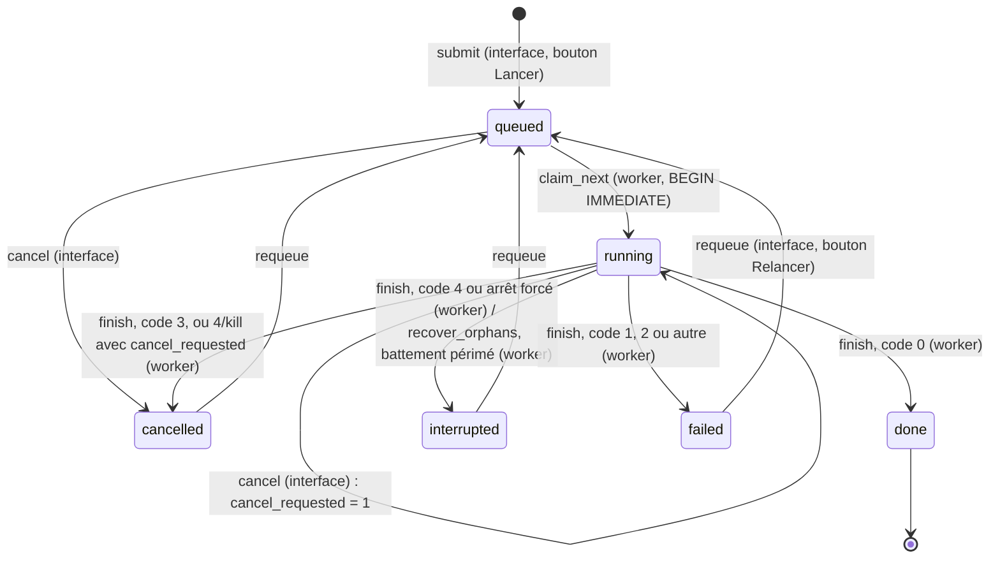

# Conception de la plateforme d'entraînement

Document de référence de la plateforme d'entraînement pilotée par l'interface web. **Il fait foi** pour
tous les agents : signatures, types, valeurs par défaut, exceptions, codes de retour, schéma SQL,
format des checkpoints. Un agent qui a besoin de s'en écarter le signale dans son compte rendu au lieu
de changer le contrat de son côté.

Conventions rappelées (voir `CLAUDE.md`) : tout est en français ; chaque module, classe, fonction et
méthode de `aidge_in_space/` a une docstring `"""! @brief ...` (`@param`, `@return`, `@throws`,
`@copydoc aidge_in_space.x.y`) et chaque constante, attribut ou champ de dataclass un commentaire
`## ...` sur la ligne au-dessus (jamais de `@var` dans une docstring de classe). Le notebook
`balle2017_end2end.ipynb` n'est ni modifié ni exécuté.

Hors périmètre : export Aidge, Celery, Redis, MLflow, base serveur, autre framework web, gestion
d'utilisateurs avancée, modification du modèle (`nn.py`), du codeur arithmétique ou des codecs (sauf le
regroupement par série de `codecs/balle2017.py`).

---

## 1. Vue d'ensemble

### 1.1 Architecture

```
 Navigateur
     │ HTTP (127.0.0.1:7860 par défaut ; authentification obligatoire si exposé)
     ▼
 Gradio : aidge_in_space.app  (banc d'essai existant + onglets Données, Entraînement, Suivi
     │                          de aidge_in_space.ui_training)
     │  JobStore : submit / cancel / requeue ; lit jobs, métriques, train.log, workers
     ▼
 RUNS_DIR/runs.sqlite  (file SQLite, journal DELETE)        data/train/<nom>/  (écrit par l'onglet Données)
     ▲   ▲
     │   │ JobStore : claim_next / heartbeat / worker_heartbeat / finish / recover_orphans
     │   │
     │  aidge_in_space.worker  (processus séparé, service Docker « worker » ; un job à la fois)
     │   │  subprocess.Popen([python, -m, aidge_in_space.train, --job-id, N, --db, …, --watch-stdin],
     │   │                   stdin=PIPE, stdout+stderr -> RUNS_DIR/N/train.log)
     │   ▼
     │  aidge_in_space.train --job-id N   (sous-processus d'entraînement)
     │      JobStore : get / set_ckpt_path / reset_progress / log_metrics / cancel_requested
     └──────┘
            │ torch.save atomique
            ▼
 outputs/checkpoints/bls2017_c{in_ch}_N{N}_lambda{λ:g}_run{N}.pt
            │ découvert par aidge_in_space.codecs.balle2017.codecs() (bouton « Recharger les codecs »,
            ▼ ou rechargement automatique quand un job passe à done)
 Banc d'essai (Comparer, Explorer, Benchmark, Encodeur embarqué)
```

Principes non négociables :

- L'interface n'entraîne jamais elle-même et ne lance aucun processus : elle écrit des jobs et lit leur état.
- Un worker exécute un seul job à la fois, chacun dans un sous-processus qu'il surveille. Un plantage
  d'entraînement ne tue jamais le worker.
- Le processus `train` n'écrit jamais le statut d'un job : c'est le worker qui le fixe à partir du code
  de retour.

### 1.2 Qui écrit quoi dans la base

| Acteur | Écrit | Lit |
| :- | :- | :- |
| Interface (`ui_training`) | `submit`, `cancel`, `requeue` | `list_jobs`, `get`, `metrics`, `worker_alive`, `job_dir` (pour `train.log`) |
| Worker (`worker`) | `claim_next`, `heartbeat`, `worker_heartbeat`, `finish`, `recover_orphans` | `get`, `cancel_requested`, `job_dir` |
| Processus `train --job-id` | `set_ckpt_path`, `reset_progress`, `log_metrics` (qui met à jour `last_step`) | `get`, `cancel_requested` (au plus une lecture toutes les 5 s) |

Sur disque : l'interface écrit `data/train/<nom>/` ; le worker crée `RUNS_DIR/<id>/` et `train.log`
(stdout et stderr de `train`, en ajout) ; `train` écrit `RUNS_DIR/<id>/config.yaml` et les checkpoints.

---

## 2. Contrats figés

Règle générale de testabilité : les chemins par défaut (`RUNS_DIR`, `TRAIN_DIR`, `CKPT_DIR`,
`KODAK_DIR`, `ROOT`) sont lus **au moment de l'appel** via le module (`from .. import config` puis
`config.RUNS_DIR`), jamais copiés à l'import, pour que les tests puissent faire
`monkeypatch.setattr(aidge_in_space.config, "RUNS_DIR", tmp_path)`. Exception existante conservée :
`codecs/balle2017.py` garde `from ..config import CKPT_DIR` (les tests patchent `balle2017.CKPT_DIR`).

### 2.1 `aidge_in_space/config.py` (ingénieur file d'attente)

Ajouts uniquement (et `import os`) :

```python
## Base de la file d'entraînement (runs.sqlite) et dossiers des jobs ; surchargeable par AIDGE_RUNS_DIR.
RUNS_DIR = Path(os.environ.get("AIDGE_RUNS_DIR", OUT_DIR / "runs"))
## Jeux d'images d'entraînement, un sous-dossier par jeu (exclus des jeux du banc par images.datasets()).
TRAIN_DIR = DATA_DIR / "train"
```

### 2.2 `aidge_in_space/training/config.py` (ingénieur entraînement)

Module sans dépendance à torch (seulement `dataclasses`, `yaml`, `pathlib`), importable à faible coût.

```python
class ConfigError(ValueError):
    """! @brief Configuration d'entraînement invalide (code de retour 2 de la CLI train)."""

@dataclass
class TrainConfig:
    ## Nom du run (facultatif ici ; obligatoire pour un job) : regroupe les checkpoints en série dans le banc.
    name: str = ""
    ## Auteur (facultatif).
    author: str = ""
    ## Dossier des images d'entraînement, relatif à config.ROOT ou absolu.
    train_dir: str = "data/train"
    ## Dossier des images d'évaluation (Kodak par défaut), relatif à config.ROOT ou absolu.
    eval_dir: str = "data/kodak"
    in_ch: int = 1               # 1 = gris, 3 = RGB
    N: int = 128
    gdn_last: bool = True
    lmbda: float = 2048
    crop: int = 256
    batch_size: int = 16
    lr: float = 1e-4
    steps: int = 50_000
    lr_decay_at: float = 0.8
    grad_clip: float = 5.0
    eval_every: int = 2_500
    n_patches: int = 8_000
    seed: int = 1234
    log_every: int = 200
    save_every: int = 5_000
    n_eval_images: int = 4
```

(Dans le code, chaque champ porte son commentaire `## ...` au-dessus ; les commentaires de fin de
ligne ci-dessus ne sont qu'un résumé.)

`TrainConfig()` se construit avec ses seules valeurs par défaut (nom vide compris). L'obligation d'un
nom non vide n'est **pas** dans `TrainConfig` : elle est vérifiée par `JobStore.submit` et
`ui_training.launch_jobs` ; en mode `--config`, la CLI remplace un nom vide par le nom du fichier YAML
sans extension (§ 2.4).

Valeurs par défaut = notebook (cellule 4, mode GPU complet ; `log_every=200`, `save_every=5000` et
`SEED=1234` de la cellule 17 et de l'en-tête). `num_workers` du notebook n'est **pas** repris : la
banque de patchs remplace le `DataLoader` (voir § 10).

Méthodes :

| Signature | Rôle | Exceptions |
| :- | :- | :- |
| `__post_init__(self) -> None` | normalise `name` et `author` (strip) puis appelle `validate()` | `ConfigError` |
| `validate(self) -> None` | règles ci-dessous | `ConfigError` |
| `from_dict(cls, d: dict) -> TrainConfig` (classmethod) | champs absents = défauts | `ConfigError` (clé inconnue, type, valeur) |
| `from_yaml(cls, path: str \| Path) -> TrainConfig` (classmethod) | `yaml.safe_load` en UTF-8 puis `from_dict` | `FileNotFoundError` ; `ConfigError` si YAML illisible ou racine non mapping |
| `to_dict(self) -> dict` | tous les champs, types Python natifs, `lmbda` en `int` s'il est entier ; JSON-sérialisable (stocké dans la base) | aucune |
| `to_yaml(self, path: str \| Path \| None = None) -> str` | YAML de `to_dict()` (ordre des champs, `sort_keys=False`, `allow_unicode=True`) ; écrit le fichier en UTF-8 si `path` | `OSError` |
| `to_cfg_dict(self) -> dict` | dictionnaire `cfg` du checkpoint : `to_dict()` sans `name` ni `author` (qui vont dans `run`) | aucune |
| propriété `mode -> str` | `"gris"` si `in_ch == 1`, sinon `"rgb"` (mode de `aidge_in_space.images`) | aucune |

Fonctions et constantes du module :

```python
## Préréglages : champs de TrainConfig (sans name, author, train_dir, eval_dir, lmbda).
PRESETS = {"test_rapide": {...}, "standard": {...}}      # valeurs au § 6
def schedule_for(steps: int) -> dict                       # voir ci-dessous
def resolve_path(p: str | Path) -> Path                    # absolu tel quel, sinon config.ROOT / p
```

`schedule_for(steps)` renvoie les réglages non exposés dans l'interface, déduits du nombre de pas :

```python
{"log_every":     min(200, max(10, steps // 30)),
 "eval_every":    min(2500, max(50, steps // 20)) if steps >= 1000 else max(1, steps // 2),
 "save_every":    min(5000, max(100, steps // 10)),
 "n_eval_images": 2 if steps < 1000 else 4}
```

Contrôle : `schedule_for(300)` = 10 / 150 / 100 / 2 (préréglage Test rapide, `eval_every` du notebook en
mode rapide) ; `schedule_for(50000)` = 200 / 2500 / 5000 / 4 (valeurs du notebook).

**Règles de validation** (message type : `"<champ> : <problème> (reçu <valeur>)"`) :

| Champ | Type accepté | Règle |
| :- | :- | :- |
| clé | - | inconnue : `ConfigError("clé de configuration inconnue : 'xxx'")` |
| champs `int` | `int`, ou `float` de valeur entière ; jamais `bool` | sinon `ConfigError("crop : entier attendu (reçu 'abc')")` |
| champs `float` | `int` ou `float` (pas `bool`), fini | |
| `gdn_last` | `bool` uniquement | |
| `name` | `str` | après strip : 0 à 60 caractères, aucun caractère de contrôle (vide accepté) |
| `author` | `str` | après strip : 0 à 60 caractères, aucun caractère de contrôle |
| `train_dir`, `eval_dir` | `str` | non vide (l'existence est vérifiée au démarrage de `train`, pas ici) |
| `in_ch` | | 1 ou 3 |
| `N` | | 8 ≤ N ≤ 512 |
| `lmbda` | | 0 < λ ≤ 100 000 |
| `crop` | | multiple de 16, 32 ≤ crop ≤ 1024 |
| `batch_size` | | 1 ≤ b ≤ 256 |
| `lr` | | 0 < lr ≤ 0,01 |
| `steps` | | 1 ≤ steps ≤ 10 000 000 |
| `lr_decay_at` | | 0 < x ≤ 1 |
| `grad_clip` | | > 0 |
| `eval_every`, `log_every`, `save_every` | | ≥ 1 |
| `n_patches` | | 1 ≤ n ≤ 200 000 et `n_patches * in_ch * crop * crop ≤ 2**31` (banque de 2 Gio au plus) |
| `seed` | | ≥ 0 |
| `n_eval_images` | | 1 ≤ n ≤ 24 |

### 2.2 bis `aidge_in_space/training/imaging.py` (ingénieur entraînement, ajout de la phase 3)

Module léger, sans torch, partagé par l'entraînement et l'interface :

```python
def to_8bit(img: PIL.Image.Image) -> tuple[PIL.Image.Image, bool]
```

Modes `I;16*`, `I` et `F` : mise à l'échelle linéaire de [0, max] vers [0, 255] (max = valeur maximale
de l'image ; une image nulle ou négative donne du noir), résultat en mode `L`. Les autres modes sont
renvoyés inchangés. Le booléen vaut `True` s'il y a eu conversion. Sans cela, `convert("L")` écrête
les images 16 bits (fréquentes pour les données lunaires) : 93,6 % de pixels à 255 sur un essai.
`ui_training.create_dataset` réécrit en 8 bits les images converties, avec un avertissement.

### 2.3 `aidge_in_space/training/loop.py` (ingénieur entraînement)

Réutilise `aidge_in_space.nn.Balle2017(in_ch, N, gdn_last)` (aucune architecture recréée) et
`aidge_in_space.images` (`IMAGE_EXTS`, `list_images`, `load_image`, `to_tensor`, `download_kodak`).
`training/__init__.py` réexporte `TrainConfig`, `ConfigError`, `train` et `TrainResult`.

```python
## Borne inférieure des probabilités (comme le notebook) avant -log2.
LIKELIHOOD_MIN = 1e-9

@dataclass
class TrainResult:
    ## "done" (dernier pas atteint, ou checkpoint déjà complet) ou "cancelled" (should_stop vrai).
    status: str
    ## Dernier pas effectué, égal au pas du checkpoint sauvegardé.
    step: int
    ## Chemin du checkpoint.
    ckpt_path: Path
    ## Historique (mêmes clés que le notebook, voir plus bas).
    history: dict
    ## Dernière évaluation {"psnr": float, "bpp": float, "source": str}, ou None.
    final_eval: dict | None
```

| Signature | Contrat |
| :- | :- |
| `seed_everything(seed: int) -> None` | `random.seed`, `numpy.random.seed`, `torch.manual_seed` (et `torch.cuda.manual_seed_all`) |
| `select_device(prefer: str = "auto") -> torch.device` | `"auto"` : CUDA si disponible, sinon CPU en affichant `ATTENTION : aucun GPU CUDA détecté, entraînement sur CPU (beaucoup plus lent).` ; `"cpu"` ; `"cuda"` indisponible : `ConfigError`. Sur CUDA, active `cudnn.benchmark` et TF32 (`torch.backends.cuda.matmul.allow_tf32`, `torch.backends.cudnn.allow_tf32`). Sur CPU, `torch.set_num_threads(max(1, (os.cpu_count() or 2) - 1))` pour laisser un cœur à l'interface |
| `init_reference_weights(model: Balle2017) -> Balle2017` | en place, puis renvoie le modèle : `nn.init.xavier_normal_(w, gain=math.sqrt(2))` et biais à 0,01 sur `g_a.conv1..3` et `g_s.deconv1..3` (init du notebook) ; GDN et prior inchangés |
| `forward_train(model: Balle2017, x: Tensor) -> dict` | `y = g_a(x)` ; si `model.training` : `y_hat = y + U(-0,5 ; 0,5)` (`torch.empty_like(y).uniform_(-0.5, 0.5)`), sinon `y_hat = torch.round(y)` (médianes nulles de `FactorizedDensity`) ; `x_hat = g_s(y_hat)` ; renvoie `{"y", "y_hat", "x_hat", "likelihoods": model.entropy_model.likelihood(y_hat)}` (probabilités **non bornées**) |
| `rd_loss(out: dict, x: Tensor, lmbda: float) -> tuple[Tensor, Tensor, Tensor]` | `(loss, mse, bpp)` avec `bpp = Σ -log2(clamp(p, LIKELIHOOD_MIN)) / (B·H·W)`, `mse = F.mse_loss(x_hat, x)`, `loss = λ·mse + bpp` ; tenseurs scalaires sur le device, sans synchronisation |
| `evaluate(model, images: list[Tensor], device) -> tuple[float, float]` | `(psnr, bpp)` moyens. Pour chaque image 1 x C x H x W : padding par réplication à un multiple de 16, `model.eval()`, `torch.no_grad()`, vrai arrondi, `x_hat[..., :H, :W].clamp(0, 1)` ré-arrondi sur 8 bits (`round(x·255)/255`), PSNR (100 si MSE nulle), bpp = bits bornés à 1e-9 / (H·W). Laisse le modèle en mode `eval` |
| `build_patch_bank(paths: list[Path], n_patches: int, crop: int, in_ch: int, device) -> Tensor` | si `len(paths) > n_patches`, tirage reproductible (graine) de `n_patches` images **avant** tout décodage, pour que la banque ne dépasse jamais `n_patches` patchs (phase 3) ; chaque image passe par `training.imaging.to_8bit` (les images 16 bits sont mises à l'échelle, avec un avertissement unique dans le journal) ; ensuite comme le notebook : `per_img = ceil(n_patches / len(paths))` patchs par image ; un facteur aléatoire par image `uniform(max(crop/min(w,h), 0,3), 0,75)` si `crop/min(w,h) ≤ 0,75` ; agrandissement bicubique si l'image est plus petite que `crop` ; recadrages aléatoires. Renvoie un tenseur `uint8` (n, C, crop, crop) sur `device` et affiche `"{n} patchs {forme} en {t} s, {Mo} Mo sur {device}"`. Image illisible : ignorée avec un avertissement. `ConfigError` si `paths` est vide ou si aucune image n'est lisible |
| `sample_batch(bank: Tensor, batch_size: int) -> Tensor` | tirage avec remise sur `bank.device`, conversion `float/255`, retournements horizontal et vertical avec probabilité 0,5 chacun (tout le lot) |
| `checkpoint_path(cfg: TrainConfig, job_id: int \| None = None, ckpt_dir: Path \| None = None) -> Path` | `ckpt_dir` (défaut `config.CKPT_DIR` lu à l'appel) `/ f"bls2017_c{in_ch}_N{N}_lambda{lmbda:g}{'' if job_id is None else f'_run{job_id}'}.pt"`. Exemple : `bls2017_c1_N128_lambda2048_run12.pt` ; mode `--config` : `bls2017_c1_N128_lambda2048.pt` (nom du notebook) |
| `save_checkpoint(path: Path, model, optimizer, cfg: TrainConfig, history: dict, step: int, run_info: dict) -> Path` | écriture atomique (§ 2.3.2) ; renvoie `path` |
| `load_checkpoint(path: Path, map_location="cpu") -> dict` | `torch.load(path, map_location=map_location, weights_only=True)` ; `FileNotFoundError` si absent ; autres erreurs propagées |
| `git_commit() -> str` | lit `config.ROOT/.git` sans sous-processus (fichier `HEAD`, référence, `packed-refs`, `.git` fichier `gitdir:` d'un worktree) ; 12 caractères hexadécimaux, `""` en cas d'échec (l'image Docker n'a pas `git`) |
| `train(cfg, ckpt_path, *, run_info=None, device=None, should_stop=None, on_metrics=None) -> TrainResult` | voir § 2.3.1 |

Signature complète de `train` :

```python
def train(cfg: TrainConfig, ckpt_path: Path, *,
          run_info: dict | None = None,                  # clé "run" du checkpoint (sans "date", ajoutée à chaque sauvegarde)
          device: torch.device | None = None,           # None : select_device("auto")
          should_stop: Callable[[], bool] | None = None,
          on_metrics: Callable[[int, dict], None] | None = None) -> TrainResult
```

`run_info` par défaut : `{"job_id": None, "name": cfg.name, "author": cfg.author, "commit": git_commit()}`.
Un nom vide est accepté par `train` (appel direct, tests) : `codecs/balle2017.py` le range alors dans la
série de slug `run`.

#### 2.3.1 Déroulement de `train`

1. **Données.** `train_paths = list_images(resolve_path(cfg.train_dir))`. Si vide : repli sur les
   images d'évaluation (comme le notebook, avertissement « entraînement sur les images d'évaluation :
   scores optimistes ») **seulement si** `resolve_path(cfg.train_dir) == config.TRAIN_DIR` (dossier
   racine `data/train`, valeur par défaut des fichiers `configs/`) ; sinon `ConfigError("aucune image
   dans <dossier>")`.
2. **Évaluation (règle de repli Kodak).** `eval_paths = list_images(resolve_path(cfg.eval_dir))`.
   Si vide et que `eval_dir` désigne `config.KODAK_DIR`, appel de `download_kodak(config.KODAK_DIR)`
   (sans exception hors ligne) puis nouvelle lecture. Si toujours vide : repli sur les
   `n_eval_images` premières images (triées) du jeu d'entraînement, avertissement
   `ATTENTION : images d'évaluation absentes (<dossier>) : évaluation sur N images du jeu d'entraînement (scores optimistes).`
   et `source = "train"` ; sinon `source = "kodak"` si `eval_dir` est `KODAK_DIR`, `"eval"` pour un
   autre dossier. On garde les `n_eval_images` premières images triées, chargées par
   `load_image(p, cfg.mode)` puis `to_tensor`. Si les deux jeux sont vides : `ConfigError`.
3. **Reprise.** Si `ckpt_path` existe : `load_checkpoint`. Refus (`ConfigError`, message qui invite à
   déplacer ou supprimer le fichier) si : clé `run` absente (checkpoint du notebook), ou
   `run["job_id"]`/`run["name"]` différents de `run_info`, ou `cfg` incompatible (`in_ch`, `N`,
   `gdn_last`, `lmbda`). Si `ck["step"] >= cfg.steps` : rien à faire, renvoie `TrainResult("done", ck["step"], …)`
   sans réécrire le fichier. Sinon : chargement de `state_dict`, `optimizer`, `history`, départ à
   `ck["step"] + 1`, graine `seed_everything(cfg.seed + ck["step"])` (la reprise n'est pas
   bit à bit identique à un entraînement d'une traite). Sans checkpoint : `seed_everything(cfg.seed)`,
   modèle `Balle2017(...)` puis `init_reference_weights`.
4. **Boucle** (fidèle à la cellule 17) : Adam (`lr`), lr multiplié par 0,1 au pas
   `int(lr_decay_at * steps)` (en reprise, le lr déjà réduit est dans l'état de l'optimiseur) ;
   `model.train()` à chaque pas ; `sample_batch` ; `forward_train` ; `rd_loss` ;
   `zero_grad(set_to_none=True)` ; `backward` ; `clip_grad_value_(grad_clip)` ; `step`. Perte, MSE et
   bpp cumulés **sur le device** et lus (une seule synchronisation) tous les `log_every` pas et au
   dernier pas.
5. **Arrêt.** `should_stop()` est appelé **à la fin de chaque pas**, après `optimizer.step()`. Il ne
   doit provoquer aucune synchronisation GPU (pas de `.item()`). S'il renvoie vrai : sauvegarde au pas
   courant, puis `TrainResult("cancelled", step, …)`. Les cumuls partiels depuis le dernier
   `log_every` sont abandonnés.
6. **Journal, évaluation, sauvegarde.** Tous les `log_every` pas (et au dernier) : ligne sur stdout et
   `on_metrics(step, {"kind": "train", …})`. Tous les `eval_every` pas (et au dernier) : `evaluate`,
   ligne `   -> <source> (arrondi) : x bpp, y dB`, `on_metrics(step, {"kind": "eval", …})`. Tous les
   `save_every` pas (et au dernier) : `save_checkpoint`. Une exception levée par `on_metrics` est
   affichée en avertissement et n'interrompt pas l'entraînement.

Dictionnaires passés à `on_metrics(step: int, data: dict)` (valeurs `float`/`int`/`str` Python natifs) :

| `kind` | Clés |
| :- | :- |
| `"train"` | `kind`, `loss`, `mse`, `bpp`, `psnr` (de la MSE moyenne, `10·log10(1/max(mse, 1e-10))`), `it_s` (pas par seconde depuis le journal précédent), `eta_s` (`(steps - step) / it_s`), `lr`, `steps` |
| `"eval"` | `kind`, `bpp`, `psnr`, `source` (`"kodak"`, `"eval"` ou `"train"`), `n_images` |

Historique (clé `history` du checkpoint, listes de nombres Python) : exactement les clés du notebook
`step`, `loss`, `bpp`, `psnr`, `eval_step`, `eval_psnr`, `eval_bpp`. En reprise, les listes sont
prolongées.

#### 2.3.2 Format et écriture des checkpoints

```python
torch.save({
    "state_dict": model.state_dict(),
    "cfg": cfg.to_cfg_dict(),            # lmbda en int s'il est entier ; in_ch, N, gdn_last, lmbda, steps… lus par codecs/balle2017.py
    "history": dict(history),            # clés du notebook
    "step": int(step),
    "optimizer": optimizer.state_dict(),
    "run": {"job_id": int | None, "name": str, "author": str, "commit": str, "date": str},
}, tmp)
```

- `run["date"]` : date locale de **cette sauvegarde**, ISO 8601 à la seconde (`datetime.now().isoformat(timespec="seconds")`).
- Tout le contenu doit être relisible avec `torch.load(..., weights_only=True)` (défaut de torch ≥ 2.6,
  utilisé par `codecs/balle2017.py`) : uniquement tenseurs, `int`, `float`, `bool`, `str`, `None`,
  listes et dictionnaires. **Jamais** de `Path`, de `datetime`, de scalaire numpy ni d'objet
  `TrainConfig`.
- Écriture atomique : `tmp = path.with_name(path.name + f".tmp-{os.getpid()}")` (ne correspond pas au
  motif `*.pt`), `torch.save(..., tmp)`, puis `os.replace(tmp, path)` ; en cas de `PermissionError`
  (fichier ouvert en lecture sous Windows), 10 nouvelles tentatives espacées de 0,5 s, puis l'erreur
  est relevée ; le fichier temporaire est supprimé en cas d'échec. Le dossier est créé si besoin.
- Le nom est toujours reconnu par le motif `bls2017_c*_N*_lambda*.pt` de `codecs/balle2017.py`.

### 2.4 CLI `python -m aidge_in_space.train` (`aidge_in_space/train.py`, ingénieur entraînement)

```
python -m aidge_in_space.train (--config FICHIER.yaml | --job-id N) [--db CHEMIN] [--out DOSSIER]
                               [--device auto|cpu|cuda] [--watch-stdin]
```

| Argument | Rôle |
| :- | :- |
| `--config FICHIER` | configuration YAML (`TrainConfig.from_yaml`) ; si `name` est vide, il est remplacé par le nom du fichier sans extension (`Path(FICHIER).stem`, par exemple `test_rapide`) ; checkpoint sans suffixe `_run` ; `run["job_id"] = None` |
| `--job-id N` | job de la base ; exclusif avec `--config` (l'un des deux est obligatoire) |
| `--db CHEMIN` | base (défaut `config.RUNS_DIR / "runs.sqlite"`) ; utilisé avec `--job-id` |
| `--out DOSSIER` | dossier des checkpoints (défaut `config.CKPT_DIR`) ; sert aux essais et aux tests |
| `--device` | voir `select_device` (défaut `auto`) |
| `--watch-stdin` | surveille la fin de stdin (voir plus bas) |

Point d'entrée testable : `main(argv: list[str] | None = None) -> int` ; le module se termine par
`if __name__ == "__main__": sys.exit(main())`. Les erreurs d'arguments d'`argparse` lèvent
`SystemExit(2)` (code standard, cohérent avec « configuration invalide »). `main` reconfigure stdout
et stderr en UTF-8.

**Codes de retour** (constantes définies dans `aidge_in_space/jobs.py`, importées par `train.py` et
`worker.py`) :

| Code | Constante | Cas |
| :- | :- | :- |
| 0 | `EXIT_DONE` | entraînement terminé, ou checkpoint déjà complet |
| 1 | `EXIT_FAILED` | toute autre exception (trace complète sur stderr, donc dans `train.log`) |
| 2 | `EXIT_CONFIG` | configuration invalide : `ConfigError`, YAML absent ou illisible, job inconnu, job non `running`, dossier d'images vide, checkpoint existant incompatible, CUDA demandé mais absent |
| 3 | `EXIT_CANCELLED` | annulation demandée dans la base (`cancel_requested`), checkpoint sauvegardé |
| 4 | `EXIT_STOPPED` | arrêt demandé par fin de stdin (`--watch-stdin`), SIGINT, SIGTERM ou SIGBREAK (Windows), checkpoint sauvegardé |

**Déroulement en mode `--job-id`** :

1. `store = JobStore(db)`, `job = store.get(id)` (`KeyError` → 2) ; si `job.status != "running"` → 2
   (`le job N n'est pas en cours (statut …)`).
2. `cfg = TrainConfig.from_dict(job.config)` (→ 2 si invalide).
3. Écrit `store.job_dir(id) / "config.yaml"` (`cfg.to_yaml(path)`, dossier créé si besoin).
4. `path = checkpoint_path(cfg, job_id, out)` puis `store.set_ckpt_path(id, str(path))`.
5. Vérifie `should_stop()` une première fois ; si vrai, sort avec 3 ou 4 sans entraîner.
6. Détermine le pas de départ (0, ou `ck["step"]` si le checkpoint est repris) et appelle
   `store.reset_progress(id, pas_de_départ)` (efface les métriques postérieures, remet `last_step`).
7. `train(...)` avec `on_metrics = lambda step, d: store.log_metrics(id, step, d["kind"], d)`.
   Une erreur SQLite de `log_metrics` est affichée en avertissement et ignorée (l'entraînement continue).
8. Code de retour : 0 si `status == "done"` ; si `"cancelled"`, 3 si la cause est l'annulation dans la
   base, 4 sinon (si les deux causes surviennent, l'annulation l'emporte : 3).

En mode `--config`, mêmes étapes sans base (pas d'étapes 1, 3, 4, 6, 7 côté base), avec le nom par
défaut tiré du fichier ; `should_stop` ne regarde que stdin et les signaux ; code 4 sur Ctrl+C.

**`should_stop` de la CLI** (classe `StopWatcher(store=None, job_id=None, watch_stdin=False, poll_s=5.0)`,
instance appelable `() -> bool`, attribut `reason: str | None` parmi `"cancel"`, `"stdin"`, `"signal"`) :

- appelée à chaque pas par la boucle : elle ne fait que lire des drapeaux en mémoire, sauf la lecture
  de la base ;
- lecture de `store.cancel_requested(job_id)` **au plus une fois toutes les 5 s** (`time.monotonic`),
  résultat mémorisé entre deux lectures ; une erreur SQLite est traitée comme « pas d'annulation »
  avec un avertissement ;
- gestionnaires de SIGINT et SIGTERM (et SIGBREAK sous Windows) qui positionnent `reason = "signal"`
  (pas de `KeyboardInterrupt`).

**`--watch-stdin`** : un thread démon lit le descripteur 0 avec `os.read(0, 1)` en boucle (données
ignorées) jusqu'à la fin de fichier ou une exception, puis positionne `reason = "stdin"`. On n'utilise pas
`sys.stdin.buffer` : sous Windows, un fil bloqué dans ce tampon fait planter l'interpréteur à l'arrêt
normal (« _enter_buffered_busy »), et le code de retour reçu par le worker est alors faux. `main()` sort
par `os._exit(code)` après avoir vidé stdout. Le worker n'écrit
jamais sur ce tube : il le ferme pour demander l'arrêt, et le système le ferme si le worker disparaît.
Dans les deux cas l'entraînement sauvegarde au pas courant et sort avec le code 4.

**Job repris par un autre processus** (ajout de la phase 3) : à chaque lecture de la base, `StopWatcher`
vérifie aussi que le job est toujours `running` et que `attempts` n'a pas changé depuis le démarrage.
Sinon, un autre processus a repris le job (worker tué, job récupéré par `recover_orphans` puis relancé).
L'entraînement s'arrête alors **sans sauvegarder**, pour ne pas écraser le checkpoint de l'autre
processus, et sort avec le code 4.

**Sortie standard** (redirigée vers `train.log` par le worker ; chaque ligne avec `flush=True`) :

```
Job 12 · « lune-lro » · λ=2048 · N=128 · gris · auteur : Alice
Appareil : cuda (NVIDIA GeForce RTX 3060)          | ou la ligne ATTENTION du CPU
Entraînement : data/train/lune (153 images) ; évaluation : data/kodak (4 images, source kodak)
200 patchs (1, 128, 128) en 2 s, 3 Mo sur cuda
Reprise au pas 5000 : outputs/checkpoints/bls2017_c1_N128_lambda2048_run12.pt
step     200/50000 |  12.3 it/s | reste ~67.4 min | loss 0.1234 | 0.512 bpp | 30.12 dB
   -> kodak (arrondi) : 0.498 bpp, 30.01 dB
Checkpoint sauvegardé (pas 5000) : outputs/checkpoints/bls2017_c1_N128_lambda2048_run12.pt
Arrêt demandé (annulation) : checkpoint sauvegardé au pas 5123.
Terminé en 61.2 min : outputs/checkpoints/bls2017_c1_N128_lambda2048_run12.pt
```

Les erreurs de configuration s'affichent sur stderr en une phrase : `Configuration invalide : <message>`.

### 2.5 `aidge_in_space/jobs.py` (ingénieur file d'attente)

Bibliothèque standard uniquement (`sqlite3`, `json`, `time`, `os`, `socket`, `re`, `dataclasses`,
`pathlib`). La docstring du module documente le choix du journal `DELETE` (base possiblement sur un
dossier monté).

```python
## Codes de retour de python -m aidge_in_space.train.
EXIT_DONE, EXIT_FAILED, EXIT_CONFIG, EXIT_CANCELLED, EXIT_STOPPED = 0, 1, 2, 3, 4
## Statuts internes (ASCII).
STATUSES = ("queued", "running", "done", "failed", "cancelled", "interrupted")
## Libellés affichés.
STATUS_LABELS = {"queued": "En attente", "running": "En cours", "done": "Terminé",
                 "failed": "En échec", "cancelled": "Annulé", "interrupted": "Interrompu"}
## Statuts finaux qu'un job peut recevoir de finish().
FINAL_STATUSES = ("done", "failed", "cancelled", "interrupted")
## Statuts depuis lesquels requeue() est permis.
REQUEUE_FROM = ("failed", "cancelled", "interrupted")
## Nom du fichier de base dans RUNS_DIR.
DB_NAME = "runs.sqlite"
## Version du schéma (PRAGMA user_version).
SCHEMA_VERSION = 1

@dataclass
class Job:
    id: int
    status: str
    name: str
    author: str
    config: dict            # TrainConfig.to_dict(), relu depuis config_json
    in_ch: int
    N: int
    lmbda: float
    steps: int
    last_step: int
    cancel_requested: bool
    attempts: int
    worker: str | None
    ckpt_path: str | None
    error: str | None
    created_at: float       # horodatages : secondes Unix (time.time())
    queued_at: float
    started_at: float | None
    finished_at: float | None
    heartbeat_at: float | None
```

Connexions : une connexion par opération (`sqlite3.connect(path, timeout=30, isolation_level=None)`,
`PRAGMA busy_timeout = 30000`, fermée en fin d'opération), écritures dans `BEGIN IMMEDIATE … COMMIT`
courtes, **requêtes paramétrées uniquement**. `PRAGMA journal_mode = DELETE` à l'initialisation.

`JobStore` :

| Méthode | Sémantique | Exceptions |
| :- | :- | :- |
| `__init__(self, db_path: str \| Path \| None = None)` | `None` : `config.RUNS_DIR / DB_NAME` lu à l'appel. Crée le dossier et le schéma (idempotent). À la **création** d'une base neuve, initialise `sqlite_sequence` de `jobs` au plus grand `N` des fichiers `config.CKPT_DIR/bls2017_*_run{N}.pt` existants, pour qu'un id ne reprenne jamais le checkpoint d'un ancien job. Attribut `path` (chemin de la base) | `RuntimeError` si `user_version > SCHEMA_VERSION` |
| `job_dir(self, job_id: int) -> Path` | `self.path.parent / str(job_id)` (non créé) | aucune |
| `submit(self, config: dict) -> int` | insère un job `queued` (`created_at = queued_at = now`) ; colonnes dénormalisées tirées de `config` (`name`, `author`, `in_ch`, `N`, `lmbda`, `steps`) ; `config_json = json.dumps(config, ensure_ascii=False)`. Ne valide que la présence et le type de ces clés (l'interface valide avec `TrainConfig` avant) ; **le nom doit être non vide** ; renvoie l'id | `ValueError` si une clé manque, si `name` est vide après strip, si `steps < 1` ou si `config` n'est pas JSON-sérialisable |
| `get(self, job_id: int) -> Job` | | `KeyError` si inconnu |
| `list_jobs(self, limit: int \| None = 200, statuses: Iterable[str] \| None = None) -> list[Job]` | du plus récent au plus ancien (`id DESC`) ; `limit=None` : sans limite ; `statuses` : filtre (phase 3, pour que l'interface voie tous les jobs non terminés, quel que soit leur âge) | `ValueError` si un statut est inconnu |
| `claim_next(self, worker: str) -> Job \| None` | dans une seule transaction `BEGIN IMMEDIATE` : le job `queued` le plus ancien (`ORDER BY queued_at, id`) passe `running`, `started_at = heartbeat_at = now`, `worker`, `attempts += 1`, `cancel_requested = 0`, `error = NULL`. Deux workers concurrents ne prennent jamais le même job. `None` si la file est vide | aucune |
| `heartbeat(self, job_id: int) -> None` | `heartbeat_at = now` si le job est `running`, sans effet sinon | `KeyError` |
| `set_ckpt_path(self, job_id: int, path: str) -> None` | | `KeyError` |
| `reset_progress(self, job_id: int, step: int) -> None` | supprime les métriques de pas `> step`, `last_step = step` | `KeyError` |
| `log_metrics(self, job_id: int, step: int, kind: str, data: dict) -> None` | insère une ligne de métriques (`data_json`, `created_at = now`) et fait `last_step = max(last_step, step)`. **Seul écrivain de `last_step`** avec `reset_progress` | `ValueError` si `kind` n'est pas `train` ou `eval` ; `KeyError` |
| `metrics(self, job_id: int, kind: str \| None = None) -> list[dict]` | dictionnaires `{"step", "kind", "created_at", **data}` triés par pas ; pour un même `(kind, step)` seule la ligne la plus récente est gardée | `KeyError` |
| `cancel(self, job_id: int) -> str` | `queued` → `cancelled` (`finished_at = now`), renvoie `"cancelled"` ; `running` → `cancel_requested = 1` (statut inchangé, idempotent), renvoie `"cancel_requested"` | `ValueError` pour tout autre statut (`le job N est déjà terminé (Terminé) : rien à annuler`) ; `KeyError` |
| `cancel_requested(self, job_id: int) -> bool` | | `KeyError` |
| `finish(self, job_id: int, status: str, error: str \| None = None) -> None` | `running` → `status` ∈ `FINAL_STATUSES`, `finished_at = now`, `cancel_requested = 0`, `error` tronqué à 4 000 caractères ; `ckpt_path` et `last_step` conservés | `ValueError` si `status` n'est pas final ou si le job n'est pas `running` ; `KeyError` |
| `requeue(self, job_id: int) -> None` | `failed`/`cancelled`/`interrupted` → `queued` : même id (donc même checkpoint, reprise), `queued_at = now`, `error`, `started_at`, `finished_at`, `heartbeat_at`, `worker` remis à `NULL`, `cancel_requested = 0` ; `last_step`, `ckpt_path`, `attempts` conservés | `ValueError` depuis `queued`, `running` ou `done` ; `KeyError` |
| `recover_orphans(self, stale_after_s: float = 60.0) -> list[int]` | passe en `interrupted` (`error = "worker disparu (battement de cœur périmé)"`) les jobs `running` dont `heartbeat_at < now - stale_after_s` ; **seul critère** : le battement de cœur périmé (un job vivant d'un autre worker n'est jamais touché). Renvoie leurs ids | aucune |
| `worker_heartbeat(self, name: str, job_id: int \| None = None) -> None` | insère ou met à jour la ligne `workers` (`pid = os.getpid()`, `host = socket.gethostname()`, `job_id`, `seen_at = now`) | aucune |
| `worker_alive(self, max_age_s: float = 30.0) -> bool` | vrai si un worker a `seen_at ≥ now - max_age_s` | aucune |

Transitions autorisées (toute autre lève `ValueError`) :

| Depuis | Vers | Méthode | Écrite par |
| :- | :- | :- | :- |
| (création) | `queued` | `submit` | interface |
| `queued` | `running` | `claim_next` | worker |
| `queued` | `cancelled` | `cancel` | interface |
| `running` | (drapeau `cancel_requested`) | `cancel` | interface |
| `running` | `done`, `failed`, `cancelled`, `interrupted` | `finish` | worker |
| `running` | `interrupted` | `recover_orphans` | worker |
| `failed`, `cancelled`, `interrupted` | `queued` | `requeue` | interface |

### 2.6 `aidge_in_space/worker.py` (ingénieur file d'attente)

```
python -m aidge_in_space.worker [--poll 5] [--once] [--db CHEMIN]
```

```python
## Commande d'entraînement ; le worker y ajoute --job-id N --db CHEMIN --watch-stdin. Remplaçable dans les tests.
TRAIN_CMD = [sys.executable, "-m", "aidge_in_space.train"]
## Période de scrutation et des battements de cœur, en secondes.
POLL_S = 5.0
## Âge au-delà duquel un job running est orphelin.
STALE_AFTER_S = 60.0
## Délai laissé à l'enfant pour sauvegarder après la fermeture de son stdin, avant kill().
STOP_TIMEOUT_S = 60.0
## Délai après lequel le worker ferme lui-même le stdin d'un job dont l'annulation est demandée.
CANCEL_GRACE_S = 60.0
## Lignes de train.log recopiées dans l'erreur d'un job en échec.
ERROR_TAIL_LINES = 20
```

| Signature | Contrat |
| :- | :- |
| `main(argv: list[str] \| None = None) -> int` | analyse les arguments, crée `JobStore(--db)`, appelle `run_worker`, renvoie 0 |
| `run_worker(store, poll=POLL_S, once=False, cmd=None, stop_event=None, name=None) -> int` | boucle ci-dessous ; `cmd` défaut `TRAIN_CMD` ; `name` défaut `f"{socket.gethostname()}-{os.getpid()}"` (unique même si deux workers tournent sur la même machine) ; `stop_event` (`threading.Event`) créé et relié aux signaux si `None` ; renvoie le nombre de jobs traités |
| `run_job(store, job, cmd, poll, stop_event) -> str` | exécute un job, renvoie le statut final calculé |
| `final_status(rc: int \| None, cancel_requested: bool, stopping: bool, killed: bool) -> str` | fonction pure, table ci-dessous |
| `tail(path: Path, n: int = ERROR_TAIL_LINES) -> str` | `n` dernières lignes (lecture des 64 derniers Kio, UTF-8 `errors="replace"`), `""` si absent |

**Boucle** :

1. Signaux SIGINT, SIGTERM (et SIGBREAK sous Windows) → `stop_event.set()`.
2. `store.recover_orphans(STALE_AFTER_S)`.
3. Tant que `stop_event` n'est pas positionné : `worker_heartbeat(name)` ; `claim_next(name)` ;
   sans job : `--once` → sortie, sinon `recover_orphans(STALE_AFTER_S)` puis `stop_event.wait(poll)` ;
   avec un job : `run_job`, puis sortie si `--once`.
4. Toute exception d'un job ou de la base est affichée et n'arrête pas le worker (le job concerné passe
   `failed` avec le message si c'est possible).

**`run_job`** :

1. Crée `store.job_dir(id)`, ouvre `train.log` en ajout binaire et y écrit un en-tête
   `=== tentative k · <date> · worker <name> ===`.
2. Lance `subprocess.Popen(cmd + ["--job-id", str(id), "--db", str(store.path), "--watch-stdin"],
   stdin=PIPE, stdout=log, stderr=STDOUT, cwd=config.ROOT, env=os.environ + {"PYTHONIOENCODING": "utf-8", "PYTHONUNBUFFERED": "1"})`,
   arguments en liste, jamais `shell=True`. Sous Windows : `creationflags = CREATE_NEW_PROCESS_GROUP | CREATE_NO_WINDOW`
   (Ctrl+C et la fermeture de la fenêtre du worker n'atteignent pas l'enfant, qui s'arrête proprement
   par la fin de stdin). Sous Linux et macOS : `start_new_session=True`.
3. Tant que l'enfant tourne, toutes les `poll` secondes : `heartbeat(id)`, `worker_heartbeat(name, id)` ;
   si `stop_event` est positionné, fermeture du stdin de l'enfant (une seule fois) et échéance
   `STOP_TIMEOUT_S` ; si `cancel_requested(id)` est vrai depuis plus de `CANCEL_GRACE_S`, même
   fermeture (filet de sécurité si l'enfant ne lit plus la base) ; échéance dépassée : `kill()`.
4. Statut final par `final_status`, puis `finish(id, statut, erreur)`. Si `finish` lève `ValueError`
   (le job n'est plus `running`, par exemple passé `interrupted` par un autre worker après une longue
   absence de battement de cœur), le worker l'attrape, affiche un avertissement
   (`ATTENTION : le job N n'est plus en cours (statut …) : statut final <statut> non écrit`) et
   continue sans planter.

| Condition (dans l'ordre) | Statut | `error` |
| :- | :- | :- |
| `rc == 0` | `done` | `None` |
| `rc == 3` | `cancelled` | `None` |
| `cancel_requested` et (`rc == 4` ou `killed`) | `cancelled` | `None` |
| `rc == 4`, ou `stopping` et `killed` | `interrupted` | `None`, ou `arrêt forcé après 60 s` si `killed` |
| sinon (1, 2, autre, signal) | `failed` | `tail(train.log, 20)` |

**Arrêt du worker** (Ctrl+C, SIGTERM, `docker compose stop`) : fermeture du stdin de l'enfant, attente
de sa sortie (code 4) au plus `STOP_TIMEOUT_S`, `finish(interrupted)`, puis sortie. La relance est
manuelle (`requeue` depuis l'onglet Suivi). Si le worker est tué brutalement, l'enfant reçoit la fin de
stdin, sauvegarde et sort ; le job reste `running` jusqu'à ce qu'un worker (au démarrage, ou à chaque
tour de boucle au repos) appelle `recover_orphans(STALE_AFTER_S)` : il passe `interrupted` au plus
60 s après son dernier battement de cœur.

Plusieurs workers sur la même base (par exemple le lanceur double-cliqué deux fois) sont sans danger :
noms distincts, prise atomique, et `recover_orphans` ne touche que des jobs sans battement de cœur
depuis 60 s.

### 2.7 `aidge_in_space/ui_training.py` (ingénieur interface)

Toute la logique est dans des **fonctions pures** testables sans lancer Gradio ; les callbacks Gradio de
`build_tabs` ne sont que des adaptateurs qui convertissent `ValueError`/`KeyError` en `gr.Error` ou
`gr.Warning` (une phrase, jamais de trace). Les paramètres `train_dir=None` désignent
`config.TRAIN_DIR` lu à l'appel.

```python
## Choix de N proposés.
N_CHOICES = [32, 64, 96, 128, 192]
## Choix de λ proposés.
LAMBDA_CHOICES = [256, 512, 1024, 2048, 4096, 8192]
## Préréglages affichés -> (clé de training.config.PRESETS ou None, λ cochés par défaut).
PRESET_CHOICES = {"Test rapide (quelques minutes)": ("test_rapide", [2048]),
                  "Standard (plusieurs heures, GPU conseillé)": ("standard", [512, 1024, 2048, 4096]),
                  "Personnalisé": (None, None)}
## Capacité BRAM du Zynq-7020 retenue : 140 BRAM36, environ 630 Ko, soit environ 615 Kio.
BRAM_BYTES = 630_000
## Taille d'image pour l'estimation des MAC par pixel.
ESTIMATE_SHAPE = (256, 256)
## Côté minimal conseillé d'une image d'entraînement (avertissement en dessous).
MIN_SIDE = 256
## Taille maximale par défaut d'un envoi, en Mo (surchargée par AIDGE_MAX_UPLOAD_MB).
DEFAULT_MAX_UPLOAD_MB = 500
## Taille décompressée maximale d'une archive : ce facteur fois la limite d'envoi.
UNZIP_FACTOR = 2
## Nombre maximal de fichiers dans une archive.
MAX_ZIP_FILES = 10_000
## Noms réservés de Windows, refusés tels quels.
WINDOWS_RESERVED = {"CON", "PRN", "AUX", "NUL", "COM1", …, "COM9", "LPT1", …, "LPT9"}
```

| Signature | Contrat | Exceptions |
| :- | :- | :- |
| `max_upload_mb() -> int` | `AIDGE_MAX_UPLOAD_MB` (entier > 0) ou `DEFAULT_MAX_UPLOAD_MB` | `ValueError` si la variable est mal formée |
| `safe_name(name: str, max_len: int = 60) -> str` | 1) `unicodedata.normalize("NFKD")` puis ASCII en ignorant le reste ; 2) `re.sub(r"[^A-Za-z0-9._-]+", "_")` ; 3) `_` répétés fusionnés ; 4) `strip("._-")` ; 5) coupe à `max_len` puis `rstrip("._-")` ; 6) préfixe `_` si la partie avant le premier point est un nom réservé Windows. Exemples : `"Lune LRO (été)"` → `"Lune_LRO_ete"`, `"../../etc"` → `"etc"`, `"con"` → `"_con"` | `ValueError("nom invalide : …")` si le résultat est vide |
| `extract_zip(zip_path: Path, dest: Path, max_total_bytes: int, max_files: int = MAX_ZIP_FILES) -> tuple[list[Path], list[str]]` | **Contrôle de tous les membres avant toute écriture** : archive entière refusée si un nom est absolu (`/`, `\`, lettre de lecteur), contient un composant `..` (séparateurs `/` et `\`), est un lien symbolique (`(external_attr >> 16) & 0o170000 == 0o120000`) ou est chiffré ; refusée si plus de `max_files` membres ou si la somme des `file_size` déclarés dépasse `max_total_bytes`. Extraction ensuite par copie en flux avec compteur (dépassement réel → suppression des fichiers déjà écrits de cette archive et refus). Arborescence aplatie : `dest / (safe_name(stem) + suffix.lower())`, suffixe `_2`, `_3`… en cas de collision ; membres hors `IMAGE_EXTS`, dossiers, `__MACOSX/` et fichiers cachés ignorés avec un message. Renvoie (images écrites, messages) | `ValueError("archive refusée : chemin dangereux « … »")`, `ValueError("archive refusée : taille décompressée … supérieure à …")`, `ValueError("archive zip illisible")` |
| `create_dataset(name: str, files: list[str \| Path] \| None, train_dir: Path \| None = None, max_upload_mb: int \| None = None) -> tuple[Path, list[str]]` | Crée **ou complète** `train_dir / safe_name(name)` (jamais d'écrasement : suffixe `_2`…). Somme des tailles envoyées ≤ `max_upload_mb` Mio. Chaque fichier : `.zip` → `extract_zip` (budget `UNZIP_FACTOR × max_upload_mb` Mio) ; extension de `images.IMAGE_EXTS` → copie sous un nom assaini ; autre → ignoré avec message. Chaque image écrite est vérifiée par PIL (illisible ou `DecompressionBombError` → supprimée avec message ; côté < `MIN_SIDE` → gardée avec avertissement « sera agrandie »). Renvoie (dossier, messages) | `ValueError` si aucun fichier, nom invalide, envoi trop gros, archive refusée, ou si un jeu **nouvellement créé** ne contient aucune image valide (le dossier est alors supprimé) |
| `list_datasets(train_dir: Path \| None = None) -> list[dict]` | sous-dossiers directs non vides, triés par nom : `{"name": str, "path": Path, "n_images": int, "samples": list[Path]}` (au plus 6 vignettes) | aucune |
| `dataset_choices(train_dir: Path \| None = None) -> list[tuple[str, str]]` | `("nom (k images)", "nom")` | aucune |
| `estimate(mode: str, N: int, gdn_last: bool) -> dict` | profil de `Balle2017(in_ch, N, gdn_last).g_a` par `profiling.profile_module` sur `(1, in_ch, 256, 256)` puis `summarize` ; renvoie `{"params": int, "mac_per_pixel": float, "int8_bytes": int (1 octet par paramètre), "int8_kib": float, "bram_bytes": BRAM_BYTES, "fits_bram": bool (int8_bytes ≤ BRAM_BYTES), "markdown": str}`. Résultat mis en cache. Contrôle : N=32 gris tient (environ 57 000 paramètres), N=128 gris ne tient pas (environ 879 000) | `ValueError` si `mode` n'est pas `gris`/`rgb` ou si `N` est hors 8..512 |
| `preset_values(preset: str) -> dict` | valeurs des champs du formulaire : `{"N", "gdn_last", "lambdas", "steps", "batch_size", "lr", "crop", "n_patches", "seed"}` depuis `training.config.PRESETS` ; `{}` pour « Personnalisé » (formulaire inchangé) | `ValueError` si préréglage inconnu |
| `launch_jobs(store, name: str, author: str, dataset: str, mode: str, N: int, gdn_last: bool, lambdas: list, steps: int, batch_size: int, lr: float, crop: int, n_patches: int, seed: int, train_dir: Path \| None = None) -> list[int]` | Exige un nom de run non vide après strip ; vérifie que `dataset` existe et contient au moins une image ; construit pour chaque λ (dédupliqués, triés par ordre croissant) `TrainConfig.from_dict({name, author, train_dir: chemin portable du jeu, in_ch, N, gdn_last, lmbda, steps, batch_size, lr, crop, n_patches, seed, **schedule_for(steps)})`. **Toutes** les configurations sont validées avant la première soumission (tout ou rien), puis `store.submit(cfg.to_dict())` pour chacune. Renvoie les ids dans l'ordre des λ. Chemin portable : relatif à `config.ROOT` en POSIX (`data/train/lune`) si le jeu est sous `ROOT`, absolu sinon | `ValueError` (`"Donnez un nom au run."`, aucun λ, jeu absent ou vide, `ConfigError` qui est une `ValueError`) |
| `format_duration(seconds: float \| None) -> str` | `None` → `"-"` ; < 60 → `"< 1 min"` ; < 3600 → `"{m} min"` ; sinon `"{h} h {mm} min"` | aucune |
| `job_progress(job: Job, metrics_train: list[dict], now: float) -> tuple[float, float \| None]` | (progression en %, secondes restantes) : voir « Progression » ci-dessous | aucune |
| `jobs_table(store, now: float \| None = None) -> pandas.DataFrame` | colonnes **exactes** `["n°", "nom", "auteur", "statut", "λ", "N", "mode", "progression (%)", "temps restant", "créé le"]`, du plus récent au plus ancien ; statut `STATUS_LABELS`, ou `"Annulation demandée"` si `running` et `cancel_requested` ; date locale `"%Y-%m-%d %H:%M"` | aucune |
| `job_choices(store) -> list[tuple[str, int]]` | `("n°12 · lune-lro · λ=2048 · En cours", 12)` | aucune |
| `job_details(store, job_id: int \| None, n_log_lines: int = 50) -> tuple[Figure \| None, str, str]` | (figure matplotlib à 3 axes : perte ; débit entraînement (bruit) et évaluation (arrondi) ; PSNR entraînement et évaluation, légende « Kodak (arrondi) » ou « jeu d'entraînement (arrondi) » selon `source`), texte des `n_log_lines` dernières lignes de `train.log` (`"(journal vide)"` si absent), Markdown de synthèse (statut, config, checkpoint, erreur). `job_id` `None` → `(None, "", "Sélectionnez un job.")` | `KeyError` si job inconnu |
| `cancel_job(store, job_id: int, confirmed: bool) -> str` | message de confirmation (`cancel`) | `ValueError("Cochez la case de confirmation pour annuler.")` si non confirmé ; `ValueError`/`KeyError` du store |
| `requeue_job(store, job_id: int) -> str` | message (`requeue`) | `ValueError`/`KeyError` du store |
| `duplicate_config(store, job_id: int) -> dict` | valeurs du formulaire Entraînement : mêmes clés que `preset_values` plus `"name"` (`nom (copie)`), `"author"`, `"dataset"` (`Path(train_dir).name`), `"mode"`, `"preset": "Personnalisé"`, `"lambdas": [λ du job]` | `KeyError` |
| `worker_banner(store) -> str` | Markdown : « Worker actif. » ou message simple : aucun worker actif, double-cliquer sur `scripts\lancer_plateforme.bat` ou lancer `docker compose up worker` ; si un job est en cours, rappel qu'un entraînement fausse les temps du banc d'essai | aucune |
| `new_done_jobs(store, seen: set[int] \| None) -> tuple[set[int], bool]` | (ids des jobs `done`, vrai s'il y en a de nouveaux par rapport à `seen`) ; `seen is None` (premier tick) → jamais vrai | aucune |
| `build_tabs(mode, reload_outputs, reload_fn, store=None, tabs=None) -> None` | voir ci-dessous | |

**Progression et temps restant** (onglet Suivi) : progression = `100 × last_step / steps`, arrondie à
0,1 (100 pour `done`). `last_step` est écrit uniquement par `log_metrics` et `reset_progress`, donc
mis à jour tous les `log_every` pas. Temps restant, seulement pour `running` : à partir de la dernière
métrique `train` du job, `max(0, eta_s - (now - created_at))` ; `"-"` s'il n'y a pas encore de
métrique, pour `queued` et pour les statuts finaux.

**`build_tabs(mode, reload_outputs, reload_fn, store=None, tabs=None)`** : appelée dans le
`with gr.Tabs():` de `app.build()`. Crée les onglets « Données » (`id="donnees"`), « Entraînement »
(`id="entrainement"`) et « Suivi » (`id="suivi"`).

- `mode` : composant `gr.Radio` du mode de l'app (entrée de `reload_fn`) ; le mode du formulaire
  d'entraînement est un champ propre à l'onglet.
- `reload_outputs` : liste de composants mis à jour par `reload_fn` (menus de codecs et `codecs_md`).
- `reload_fn(mode_value) -> tuple` : la fonction du bouton « Recharger les codecs » (`app.reload_codecs`).
- `store` : `JobStore` ; `None` → `JobStore()` créé à la construction.
- `tabs` (ajout facultatif au brief) : le `gr.Tabs` de l'app ; s'il est fourni, « Lancer » bascule sur
  l'onglet Suivi et « Dupliquer la configuration » sur l'onglet Entraînement (`gr.Tabs(selected=…)`).
- Un `gr.Timer(5)` rafraîchit le tableau, la bannière du worker et le détail du job sélectionné ;
  quand `new_done_jobs` signale un nouveau job terminé, il appelle `reload_fn(mode)` sur
  `reload_outputs` (l'état `seen` est un `gr.State`).
- Les menus mis à jour par callback réagissent à `.input` (choix de l'utilisateur), jamais à `.change`.
- L'encart d'estimation est recalculé à chaque changement de mode, N ou GDN finale (`estimate`).
- Annuler : case « Je confirme l'annulation » obligatoire. Relancer : `requeue_job` sur un job
  `failed`, `cancelled` ou `interrupted`.

### 2.8 `aidge_in_space/app.py` : modifications minimales (ingénieur interface)

1. Factoriser au niveau du module (les deux fonctions ne renvoient que des `gr.update`) :
   - `mode_updates(m) -> tuple` : contenu actuel de `on_mode` ;
   - `reload_codecs(m) -> tuple` : `discover()`, `backends.clear_runners()`, puis
     `mode_updates(m) + (codecs_markdown(),)`.
   `build()` les utilise : `mode.change(mode_updates, …)`, `reload_btn.click(reload_codecs, mode, mode_outputs + [codecs_md])`.
2. Dans `build()`, le `with gr.Tabs() as tabs:` reçoit, après l'onglet « Codecs et aide » (pour que
   `codecs_md` existe), l'appel `ui_training.build_tabs(mode, mode_outputs + [codecs_md], reload_codecs, tabs=tabs)`.
   Les composants `mode_outputs` doivent être créés avant cet appel.
3. Fonctions pures ajoutées :
   - `parse_users(spec: str | None) -> list[tuple[str, str]]` : `"login:motdepasse,login2:motdepasse2"`,
     coupe sur `,` puis sur le **premier** `:` ; espaces autour ignorés ; `None` ou vide → `[]` ;
     login ou mot de passe vide, ou entrée sans `:` → `ValueError("AIDGE_UI_USERS mal formé : entrée n°k")`
     (le mot de passe n'apparaît jamais dans le message). Les virgules dans un mot de passe ne sont pas
     prises en charge.
   - `is_loopback(host: str) -> bool` : `"localhost"`, ou adresse IP de bouclage (`ipaddress`) ;
     `""`, `"0.0.0.0"`, `"::"` et toute autre adresse → faux.
   - `check_exposure(host: str, users: list, bind: str | None, in_docker: bool) -> None` : adresse
     effective = `bind` si `in_docker` et `bind`, sinon `host` ; si elle n'est pas de bouclage et
     que `users` est vide → `ValueError("Exposition réseau refusée : l'interface écouterait sur <adresse> sans authentification. Définissez AIDGE_UI_USERS (login:motdepasse) ou gardez 127.0.0.1.")`.
4. `main()` :
   - hôte = `--host` s'il est donné, sinon `AIDGE_UI_HOST`, sinon `127.0.0.1` (le défaut d'argparse
     devient `None`) ;
   - `users = parse_users(os.environ.get("AIDGE_UI_USERS"))` ;
   - `check_exposure(host, users, os.environ.get("AIDGE_UI_BIND"), Path("/.dockerenv").exists())` ;
   - `max_upload_mb()` ;
   - en cas de `ValueError` : message sur stderr et `SystemExit(2)` ;
   - `launch(..., auth=users or None, max_file_size=f"{mb}mb", theme=gr.themes.Soft())`.

| Variable | Défaut | Rôle |
| :- | :- | :- |
| `AIDGE_RUNS_DIR` | `outputs/runs` | dossier de la base et des journaux (`/runs` en Docker) |
| `AIDGE_UI_HOST` | `127.0.0.1` | adresse d'écoute de Gradio si `--host` est absent |
| `AIDGE_UI_USERS` | vide | comptes `login:motdepasse,…` ; obligatoire si l'adresse effective n'est pas locale |
| `AIDGE_UI_BIND` | `127.0.0.1` | Docker : adresse de l'hôte où le port 7860 est publié ; transmise au conteneur, prise en compte seulement dans Docker |
| `AIDGE_MAX_UPLOAD_MB` | 500 | taille maximale d'un envoi (Gradio `max_file_size` et `create_dataset`) |

### 2.9 `codecs/balle2017.py` : regroupement par série (ingénieur entraînement)

Seuls le regroupement, la clé, le libellé et la description changent ; le chargement des poids et
`make_model` sont inchangés.

- `slug(name: str) -> str` : NFKD → ASCII, minuscules, suites de caractères hors `[a-z0-9]`
  remplacées par `-`, `strip("-")`, coupé à 40 caractères (puis `rstrip("-")`), `"run"` si vide.
  Exemple : `"Lune LRO (été)"` → `"lune-lro-ete"`.
- Clé de groupe dans `codecs()` : `(in_ch, N, gdn_last, slug(ck["run"]["name"]))` si le checkpoint a une
  clé `run`, sinon `(in_ch, N, gdn_last, None)`.
- `Balle2017Codec.__init__(self, in_ch, N, gdn_last, entries, series=None)` ; `series` = nom du run
  (celui du premier checkpoint du groupe dans l'ordre trié des chemins). Entrées : `path`, `lmbda`,
  `step`, plus `job_id`, `name`, `author`, `complete` (`step >= cfg["steps"]`) pour une série.
- **Sans série** (`series is None`, checkpoints du notebook) : clé, libellé, description, tri et
  libellé de niveau **strictement identiques** au code actuel.
- **Série** :
  - clé `balle2017-c{in_ch}-n{N}[-sans-gdn3]-{slug(nom)}` ;
  - libellé `Ballé 2017 · N={N} · {gris|RGB}[ · sans GDN finale] · {nom}` ;
  - description `Run « {nom} » ({auteurs distincts, sinon « auteur inconnu »}), entraîné par la plateforme : k checkpoint(s).` ;
  - entrées triées par (λ, job_id) ;
  - libellé de niveau `λ={lmbda:g} ({step} pas) · {nom}[ · job {job_id}][ · en cours]`, avec le
    séparateur de milliers espace comme aujourd'hui ; `· job` absent si `job_id` vaut `None` ; `· en cours`
    si le checkpoint est intermédiaire.
- Unicité : si une clé de série est déjà prise (collision de slug avec une autre série ou avec une clé
  du notebook, par exemple un run nommé « sans gdn3 »), suffixe `-2`, `-3`… pour que `discover()` ne
  lève jamais `ValueError` à cause d'un nom de run.

### 2.10 Docker (ingénieur infra)

`docker-compose.yml` :

```yaml
services:
  notebook: …                       # inchangé
  app:
    image: aidge-in-space:latest
    build: .
    command: ["python", "-m", "aidge_in_space.app", "--host", "0.0.0.0", "--port", "7860"]
    ports: ["${AIDGE_UI_BIND:-127.0.0.1}:7860:7860"]
    environment:
      AIDGE_RUNS_DIR: /runs
      AIDGE_UI_BIND: ${AIDGE_UI_BIND:-127.0.0.1}
      AIDGE_UI_USERS: ${AIDGE_UI_USERS:-}
      AIDGE_MAX_UPLOAD_MB: ${AIDGE_MAX_UPLOAD_MB:-500}
    volumes: [".:/workspace", "runs:/runs"]
    shm_size: 1gb
  worker:
    image: aidge-in-space:latest
    command: ["python", "-m", "aidge_in_space.worker"]
    environment: {AIDGE_RUNS_DIR: /runs}
    volumes: [".:/workspace", "runs:/runs"]
    restart: unless-stopped
    stop_grace_period: 90s          # > STOP_TIMEOUT_S (60 s) du worker
    init: true                      # récupère les zombies, transmet SIGTERM au worker
    shm_size: 1gb
volumes:
  runs: {}
```

- `Dockerfile` : avant `USER aidge`, `RUN mkdir -p /runs && chown aidge:aidge /runs` (un volume nommé
  neuf hérite du propriétaire du dossier de l'image ; sans cela, `/runs` appartient à root et la base
  ne peut pas être créée).
- **Mis à jour depuis** : `docker-compose.gpu.yml` n'existe plus. `docker-compose.yml` est désormais
  la variante GPU (image CUDA `aidge-in-space:gpu`, seul le `worker` réserve la carte NVIDIA) et
  `docker-compose.cpu.yml` la surcharge pour les PC sans carte NVIDIA (image CPU, `deploy: !reset null`).
  La production utilise les images publiées par la CI (`docker-compose.prod.yml`, voir `deploiement.md`).
- **Mis à jour depuis** : l'image embarque le code (`COPY` dans le Dockerfile) pour pouvoir être
  publiée ; en local, les fichiers compose montent toujours le dépôt sur `/workspace` par-dessus.
  `.dockerignore` exclut les données, les résultats et les fichiers locaux.
- Les checkpoints restent dans `/workspace/outputs/checkpoints` (montage du dépôt) et sont visibles du
  banc d'essai, dans Docker comme dans le venv.
- **Accepté** : avec le volume nommé, `train.log` et `runs.sqlite` ne sont pas visibles depuis l'hôte
  Windows. L'onglet Suivi affiche les 50 dernières lignes du journal ; pour le reste :
  `docker compose exec worker tail -f /runs/<id>/train.log`.
- Interdit : mélanger l'interface du venv et un worker Docker. Ils n'ont de toute façon pas la même
  base (`outputs/runs` contre le volume `/runs`) : un job soumis par l'une ne serait jamais vu par
  l'autre.

---

## 3. Schéma SQL (`runs.sqlite`)

```sql
PRAGMA journal_mode = DELETE;

CREATE TABLE IF NOT EXISTS jobs (
    id               INTEGER PRIMARY KEY AUTOINCREMENT,   -- jamais réutilisé : le checkpoint porte l'id
    status           TEXT    NOT NULL DEFAULT 'queued'
                     CHECK (status IN ('queued','running','done','failed','cancelled','interrupted')),
    name             TEXT    NOT NULL,
    author           TEXT    NOT NULL DEFAULT '',
    config_json      TEXT    NOT NULL,                    -- TrainConfig.to_dict()
    in_ch            INTEGER NOT NULL,
    n                INTEGER NOT NULL,                    -- N (noms de colonnes insensibles à la casse)
    lmbda            REAL    NOT NULL,
    steps            INTEGER NOT NULL,
    last_step        INTEGER NOT NULL DEFAULT 0,
    cancel_requested INTEGER NOT NULL DEFAULT 0 CHECK (cancel_requested IN (0, 1)),
    attempts         INTEGER NOT NULL DEFAULT 0,
    worker           TEXT,
    ckpt_path        TEXT,
    error            TEXT,
    created_at       REAL    NOT NULL,                    -- secondes Unix
    queued_at        REAL    NOT NULL,
    started_at       REAL,
    finished_at      REAL,
    heartbeat_at     REAL
);
CREATE INDEX IF NOT EXISTS jobs_status_queue ON jobs (status, queued_at, id);

CREATE TABLE IF NOT EXISTS metrics (
    id         INTEGER PRIMARY KEY AUTOINCREMENT,
    job_id     INTEGER NOT NULL REFERENCES jobs (id),
    step       INTEGER NOT NULL,
    kind       TEXT    NOT NULL CHECK (kind IN ('train', 'eval')),
    data_json  TEXT    NOT NULL,
    created_at REAL    NOT NULL
);
CREATE INDEX IF NOT EXISTS metrics_job ON metrics (job_id, kind, step);

CREATE TABLE IF NOT EXISTS workers (
    name       TEXT PRIMARY KEY,                          -- f"{socket.gethostname()}-{os.getpid()}"
    pid        INTEGER NOT NULL,
    host       TEXT    NOT NULL,
    job_id     INTEGER,
    started_at REAL    NOT NULL,
    seen_at    REAL    NOT NULL
);

PRAGMA user_version = 1;
```

Le schéma est créé dans une transaction `BEGIN IMMEDIATE` si `user_version = 0` ; si
`user_version > 1`, `RuntimeError`. Aucune suppression de job n'est prévue.

---

## 4. Cycle de vie d'un job



Déclencheurs du côté de l'enfant `train` : code 3 quand il lit `cancel_requested` (au plus 5 s après
l'annulation, plus la durée d'un pas) ; code 4 sur fin de stdin (worker arrêté ou disparu) ou signal.
Une relance garde l'id : le checkpoint `…_run{id}.pt` est repris au dernier pas sauvegardé, et
`reset_progress` efface les métriques postérieures à ce pas.

---

## 5. Arborescence des fichiers produits

```
configs/                                       (versionné)
  test_rapide.yaml
  standard_gris_N128.yaml
  standard_gris_N64.yaml
data/train/<nom>/*.png|jpg|…                   onglet Données (ignoré par Git)
outputs/runs/                                  RUNS_DIR en venv ; /runs (volume nommé) en Docker
  runs.sqlite                                  JobStore (+ runs.sqlite-journal pendant une écriture)
  <id>/config.yaml                             train --job-id, au démarrage
  <id>/train.log                               worker : stdout et stderr de train, en ajout, une section par tentative
outputs/checkpoints/
  bls2017_c1_N128_lambda2048_run12.pt          train --job-id 12
  bls2017_c1_N128_lambda2048.pt                train --config (ou notebook)
  bls2017_c1_N128_lambda2048_run12.pt.tmp-4242 transitoire (sauvegarde atomique), ignoré par le banc
```

---

## 6. Préréglages et fichiers `configs/*.yaml`

`training/config.py` :

```python
PRESETS = {
    "test_rapide": dict(in_ch=1, N=128, gdn_last=True, crop=128, batch_size=4, lr=1e-4, steps=300,
                        lr_decay_at=0.8, grad_clip=5.0, eval_every=150, n_patches=200, seed=1234,
                        log_every=10, save_every=100, n_eval_images=2),
    "standard":    dict(in_ch=1, N=128, gdn_last=True, crop=256, batch_size=16, lr=1e-4, steps=50_000,
                        lr_decay_at=0.8, grad_clip=5.0, eval_every=2_500, n_patches=8_000, seed=1234,
                        log_every=200, save_every=5_000, n_eval_images=4),
}
```

| Préréglage (interface) | Valeurs | λ cochés |
| :- | :- | :- |
| Test rapide (quelques minutes) | `PRESETS["test_rapide"]` (mode rapide du notebook) | 2048 |
| Standard (plusieurs heures, GPU conseillé) | `PRESETS["standard"]` (notebook, GPU) | 512, 1024, 2048, 4096 (4 points : minimum du BD-rate) |
| Personnalisé | formulaire inchangé | inchangés |

Quel que soit le préréglage, `launch_jobs` applique `schedule_for(steps)` (cohérent avec les deux
préréglages par construction).

Fichiers (champs dans l'ordre de `TrainConfig`, lisibles par `TrainConfig.from_yaml`, cohérents avec
`PRESETS` ; un test le vérifie) :

| Fichier | Contenu |
| :- | :- |
| `configs/test_rapide.yaml` | `name: test-rapide`, `author: ""`, `train_dir: data/train`, `eval_dir: data/kodak`, `lmbda: 2048`, puis `PRESETS["test_rapide"]`. Moins de 3 min sur CPU, chronométré réellement |
| `configs/standard_gris_N128.yaml` | `name: standard-gris-n128`, `lmbda: 2048`, puis `PRESETS["standard"]` |
| `configs/standard_gris_N64.yaml` | `name: standard-gris-n64`, `lmbda: 2048`, puis `PRESETS["standard"]` avec `N: 64` |

Avec `train_dir: data/train` vide, la règle de repli du § 2.3.1 entraîne sur Kodak (comme le notebook ;
téléchargement de Kodak avec accès réseau, accepté).

---

## 7. Table de propriété des fichiers

| Phase | Agent | Fichiers |
| :- | :- | :- |
| 0 | architecte | `docs/conception_entrainement.md` |
| 1 | ingenieur-entrainement | `aidge_in_space/training/` (`__init__.py`, `config.py`, `loop.py`), `aidge_in_space/train.py`, `configs/*.yaml`, `requirements.txt` (ajout de `pyyaml` seulement), `aidge_in_space/codecs/balle2017.py` (série, clé, libellé et description seulement) |
| 1 | ingenieur-file-attente | `aidge_in_space/jobs.py` (dont les constantes `EXIT_*`), `aidge_in_space/worker.py`, `aidge_in_space/config.py` (`RUNS_DIR`, `TRAIN_DIR`) |
| 1 | ingenieur-infra | `Dockerfile`, `docker-compose.yml`, `docker-compose.gpu.yml`, `.dockerignore`, `scripts/` (nouveaux scripts ; `setup_venv.*` intacts) |
| 2 | ingenieur-interface | `aidge_in_space/ui_training.py`, `aidge_in_space/app.py` |
| 2 | testeur | `tests/test_training.py`, `tests/test_jobs.py`, `tests/test_ui_training.py`, `tests/conftest.py` |
| 3 | relecteur | aucun (lecture seule) |
| 4 | redacteur | `docs/guide_interface.md`, `README.md`, `docs/mainpage.md`, `CLAUDE.md` |

`tests/test_bench.py` reste inchangé (décision de l'orchestrateur).

Dépendances : en phase 1, `train.py` importe `jobs.JobStore` et les `EXIT_*` (écrits en parallèle :
coder contre ce document) ; le worker se teste avec une commande factice (`cmd`). En phase 2,
l'interface et le testeur travaillent en parallèle contre le § 2.7.

Indications pour le testeur : `tests/test_bench.py` paramètre ses tests sur **tous** les codecs
découverts, donc sur les vrais checkpoints de `outputs/checkpoints` ; les nouveaux tests patchent
`aidge_in_space.config.RUNS_DIR` (ou passent `JobStore(tmp_path / "runs.sqlite")`),
`aidge_in_space.config.TRAIN_DIR`, `balle2017.CKPT_DIR`, et passent `--out`/`ckpt_dir`, `eval_dir` et
`train_dir` temporaires. `app.build()` crée `JobStore()` : patcher `RUNS_DIR` avant.

---

## 8. Risques identifiés et parades

| Risque | Parade |
| :- | :- |
| **SQLite sur un dossier Windows monté dans Docker** : verrous non fiables, base corrompue | Base dans un volume nommé `/runs` (§ 2.10) ; journal `DELETE` (pas de WAL, qui exige une mémoire partagée) ; une connexion par opération, `busy_timeout` 30 s, `BEGIN IMMEDIATE` court ; interdiction de mélanger venv et Docker sur une même base |
| **Base recréée** (volume supprimé) alors que les checkpoints restent : le job 1 reprendrait `…_run1.pt` d'un ancien job | `AUTOINCREMENT` amorcé au plus grand `run{N}` existant à la création ; refus de reprise si `run.job_id`, `run.name`, l'architecture ou λ diffèrent (code 2, message clair) |
| **Processus orphelins sous Windows** (fenêtre du worker fermée, worker tué) | Enfant en `CREATE_NEW_PROCESS_GROUP \| CREATE_NO_WINDOW` : ni Ctrl+C ni la fermeture de la console ne le tuent brutalement ; il s'arrête seul à la fin de stdin, après sauvegarde. Le job resté `running` passe `interrupted` par `recover_orphans(STALE_AFTER_S)`, appelé par tout worker au démarrage et à chaque tour de boucle au repos, environ 60 s après son dernier battement de cœur (au plus 60 s plus une période de scrutation du worker, 5 s par défaut) |
| **Deux workers sur la même base** (lanceur double-cliqué deux fois) | Nom de worker `hôte-pid` unique ; `recover_orphans` ne regarde que le battement de cœur, donc jamais le job vivant d'un autre worker ; `finish` sur un job qui n'est plus `running` : `ValueError` attrapée, avertissement, pas de plantage |
| **Arrêt Docker trop court** | `stop_grace_period: 90s` > `STOP_TIMEOUT_S` (60 s) ; `init: true` |
| **`os.replace` sous Windows** : `PermissionError` si le banc lit le checkpoint au même moment | 10 nouvelles tentatives à 0,5 s ; fichier temporaire hors motif `*.pt` ; le checkpoint précédent reste intact en cas d'échec |
| **Checkpoints intermédiaires visibles dans le banc** | Libellé de niveau `· en cours` ; fichier toujours complet grâce à l'écriture atomique ; après « Recharger les codecs », `discover()` crée de nouveaux codecs (caches de modèles vidés) et `clear_runners()` vide les moteurs |
| **Tests du banc sur de vrais checkpoints** : `test_levels_increase_rate` exige un débit croissant avec λ ; le scénario du critère 3 crée dans le vrai `outputs/checkpoints` une série Test rapide à 2 λ, dont le débit n'est pas garanti croissant après 300 pas | Décision : `tests/test_bench.py` reste inchangé ; le scénario utilise deux λ éloignés, **256 et 8192**, pour que le débit soit nettement croissant. Préréglage Test rapide à un seul λ par défaut |
| **Coût de `discover()`** : chaque checkpoint (poids + état d'Adam, environ 3 fois la taille des poids) est chargé en entier | Accepté (décision de l'orchestrateur) |
| **Kodak absent hors ligne** | Tentative de téléchargement (accès réseau accepté), puis repli sur les `n_eval_images` premières images du jeu d'entraînement, avec un avertissement et `source = "train"` (légende adaptée dans Suivi) |
| **Jeu d'entraînement vide** | `ConfigError` (code 2) pour un jeu précis ; repli sur Kodak seulement pour `data/train` racine (fidèle au notebook) |
| **Contention CPU** (entraînement et banc sur le même PC) | `torch.set_num_threads(cpu_count - 1)` sur CPU ; bannière Suivi « un entraînement fausse les temps du banc » ; GPU conseillé pour Standard |
| **Zip slip** (`../`, chemin absolu, lettre de lecteur, lien symbolique) | Contrôle de tous les membres avant écriture, archive entière refusée ; arborescence aplatie et noms assainis |
| **Bombe zip et gros envois** | Somme déclarée bornée (`UNZIP_FACTOR × AIDGE_MAX_UPLOAD_MB`), compteur réel pendant l'extraction, au plus 10 000 membres ; `max_file_size` Gradio ; `DecompressionBombError` de PIL traitée |
| **Noms de fichiers dangereux** | `safe_name` (ASCII, caractères sûrs, noms réservés Windows) |
| **Exposition réseau** | Écoute par défaut `127.0.0.1` (Gradio et compose) ; refus au démarrage sans `AIDGE_UI_USERS` si l'adresse effective n'est pas locale ; `AIDGE_UI_BIND` pris en compte seulement dans Docker |
| **Injection SQL ou de commande** | Requêtes paramétrées uniquement ; sous-processus en liste, sans `shell=True` ; le nom du run n'apparaît jamais dans une commande |
| **`torch.load` avec `weights_only=True`** (défaut de torch ≥ 2.6) | Contenu du checkpoint limité aux types natifs (§ 2.3.2) |
| **Encodage cp1252 de la console Windows** | Le worker impose `PYTHONIOENCODING=utf-8` à l'enfant ; `train` et `worker` reconfigurent stdout en UTF-8 |

---

## 9. Critères d'acceptation

Critères de la section 7 du brief, avec la partie du contrat qui y répond.

| n° | Critère | Couvert par |
| :- | :- | :- |
| 1 | `python -m pytest tests` passe en entier dans le venv Windows | tests du § 7 ; docstrings partout ; `test_bench.py` inchangé, rendu sûr par le choix des λ du scénario (§ 8) |
| 2 | `python -m aidge_in_space.train --config configs/test_rapide.yaml` termine en moins de 3 min sur CPU, et le modèle apparaît dans `python -m aidge_in_space.bench --list` | § 2.4 et § 6 : checkpoint `bls2017_c1_N128_lambda2048.pt` avec `run.name = "test-rapide"`, donc codec de série `balle2017-c1-n128-test-rapide` (§ 2.9) ; repli Kodak si `data/train` est vide |
| 3 | Scénario de bout en bout exécuté réellement (détail ci-dessous) | §§ 2.4 à 2.9 |
| 4 | `docker compose up app worker` fonctionne en CPU ; variante GPU documentée et validée par `docker compose config` | § 2.10 |
| 5 | `git diff --stat -- balle2017_end2end.ipynb` vide | aucun agent ne possède le notebook (§ 7) |
| 6 | Docstring `"""!` partout | conventions en tête de document ; `test_every_definition_has_a_doxygen_docstring` |
| 7 | `CLAUDE.md`, `README.md` et `docs/guide_interface.md` à jour | phase 4, rédacteur |

Scénario du critère 3, étape par étape, avec ce qui le rend possible :

1. Lancer l'app et le worker (deux commandes, ou `docker compose up app worker`) : bannière « Worker actif » (`worker_alive`).
2. Onglet Données : créer le jeu `test` avec 5 images Kodak (`create_dataset` ; 768 x 512, au-dessus de `MIN_SIDE`).
3. Onglet Entraînement : préréglage Test rapide, **deux** λ (256 et 8192), Lancer : deux jobs (`launch_jobs`), même série.
4. Les deux jobs passent l'un après l'autre (un job à la fois par worker, ordre `queued_at`) ; courbes et journal se mettent à jour (`gr.Timer(5)`, `log_every = 10`, `job_details`).
5. Fermer l'onglet du navigateur pendant un entraînement puis le rouvrir : l'entraînement continue. Il tourne dans le worker, jamais dans l'interface, et l'état est relu dans la base.
6. Annuler un job : `cancel_requested`, puis code 3 en 5 s au plus (plus un pas), checkpoint sauvegardé, statut Annulé. Le relancer : `requeue`, même id, reprise au pas du checkpoint (`reset_progress`).
7. Tuer le worker pendant un job : l'enfant voit la fin de stdin, sauvegarde et sort. Relancer le worker : le job passe Interrompu environ 60 s après son dernier battement de cœur, au plus 60 s plus une période de scrutation (`recover_orphans` ; 61,6 s mesurées). Il est relançable (`requeue`) et reprend au pas sauvegardé.
8. Après la fin, le nouveau codec apparaît dans l'onglet Comparer avec un niveau par λ : rechargement automatique (`new_done_jobs` puis `reload_fn`), un fichier `_run{id}.pt` par job, donc un niveau par λ dans la série.

---

## 10. Points tranchés sans consigne explicite (récapitulatif)

1. `num_workers` n'est pas repris dans `TrainConfig` (inutile avec la banque de patchs) ; `ConfigError` sur la clé.
2. Champs ajoutés à `TrainConfig` : `train_dir`, `eval_dir`, `seed`, `log_every`, `save_every`, `n_eval_images`. `name` est facultatif dans `TrainConfig` (amendement de l'orchestrateur) ; il est obligatoire dans `JobStore.submit` et `launch_jobs`, et remplacé par le nom du fichier YAML en mode `--config`.
3. `schedule_for(steps)` fixe `log_every`, `eval_every`, `save_every` et `n_eval_images` pour les jobs de l'interface.
4. Repli d'entraînement sur Kodak limité au dossier racine `data/train`.
5. Checkpoint du notebook ou d'un autre job au même nom : refus de reprise (code 2) plutôt qu'écrasement.
6. Constantes `EXIT_*` dans `jobs.py`.
7. Méthodes `JobStore` ajoutées : `set_ckpt_path`, `reset_progress`, `cancel_requested`, `job_dir` ; colonne `queued_at`.
8. Nom du worker `f"{socket.gethostname()}-{os.getpid()}"` ; `recover_orphans(stale_after_s)` ne se fonde que sur le battement de cœur périmé (amendement de l'orchestrateur) ; `finish` refusé sur un job qui n'est plus `running` : avertissement du worker, sans plantage.
9. `CREATE_NO_WINDOW` en plus de `CREATE_NEW_PROCESS_GROUP`, et `start_new_session` sous POSIX.
10. Nom du run dans le libellé du codec **et** dans celui des niveaux ; `· job N` et `· en cours` ajoutés.
11. Paramètre facultatif `tabs` de `build_tabs`.
12. `BRAM_BYTES = 630_000` (valeur « environ 615 Kio » du brief).
